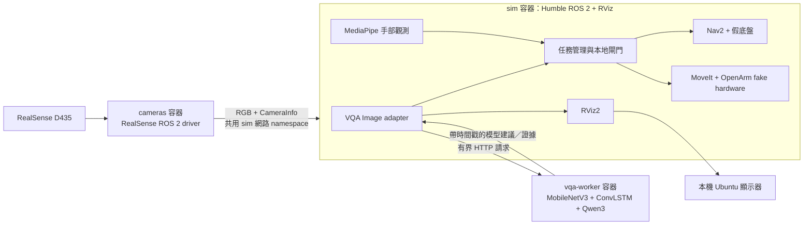

# ITRI 便利商店機器人整合系統

ROS 2 Humble 整合 OpenArm、TidyBot、RealSense 與 VQA。使用、開發、編譯及測試都在 Docker；宿主機需 Docker Engine／Compose V2、Ubuntu 桌面與 xauth，GPU 模式另需 NVIDIA Container Toolkit。

本機驗證 Compose 2.39.2；其他主機的 Compose 需支援本專案使用的 include／extends。

**目前已實測 D435 RGB → ROS Image → 原有 ConvLSTM／Qwen 模型 → 決策與 RViz 影像。** Nav2／MoveIt 已完成假硬體任務。底盤與手臂仍為 fake hardware，預設禁動；真機運動、Thor、MASt3R 尺度與腕部融合仍待驗收。

## 1. 先選擇要使用的模式

在宿主機專案根目錄執行：

```bash
cd /home/lester/obstacle_avoid
make help
```

| 目的 | 指令 | 影像／決策來源 | 專案可寫 |
|---|---|---|---|
| 純模擬使用 | `make up`、`make shell` | synthetic／fixture | 否 |
| 純模擬開發 | `make dev` | synthetic／fixture | 是 |
| 真相機＋真 VQA | `make vqa`、`make shell` | RealSense RGB／checkpoint | 否 |
| 真相機＋VQA 開發 | `make vqa-dev` | RealSense RGB／checkpoint | 是 |
| 錄影回放＋真 VQA | `make vqa-video VIDEO=/data/video/0610_take3n4.mp4` | video／checkpoint | 否 |

**RViz 直接在本機 Ubuntu 桌面開啟視窗，程式仍在 Docker 執行。** 已移除虛擬桌面、VNC、網頁服務及其連接埠。在本機已登入的桌面終端機執行上述 make 指令，會自動準備目前 DISPLAY 的私人 Xauthority，再將本機 X11 socket 唯讀掛入容器。Wayland 桌面透過既有 XWayland 使用相同入口。

`docker compose exec sim bash` 與 `make shell` 可直接進入目前容器，不切換模式。容器內的 `rviz2`、rqt 等 GUI 使用本機顯示器；整合 RViz 已自動啟動。要手動重開：

```bash
# 容器內；會新增一個本機 RViz 視窗
rviz2 -d "$(ros2 pkg prefix retail_bringup)/share/retail_bringup/rviz/retail.rviz"
```

未登入桌面、SSH 或 CPU 自動測試時使用 `make up GUI=0`，只啟動 ROS、不開任何顯示伺服器。桌面重新登入後可執行 `make gui-setup` 更新授權，再重新啟動管線。授權檔在忽略的 config/local、權限 0600；不需執行 `xhost +`。

上述模式共用同一個 sim service。切換模式或重新啟動前，先完成／取消正在進行的假硬體任務；切換後不重播舊 goal。`make up`／`make dev`／影片模式會先停止相機，避免同一 topic 有兩個擷取者。

## 2. 現在的架構與 Docker 關係



| Service | 使用的 image／職責 | 掛載與權限 |
|---|---|---|
| `sim` | `humble-sim`；所有整合 ROS 節點、Nav2、MoveIt、假機器人與本機 RViz | 標準 `/workspace:ro`；開發 overlay 改為 rw；無相機／馬達設備 |
| `cameras` | 與 sim **同一 image、獨立程序**；只跑 RealSense driver | 指定 UVC 節點、USB、唯讀相機配置；無馬達設備 |
| `vqa-worker` | 獨立 GPU image；保留模型原 Python／Torch 環境 | GPU、唯讀原始碼與 checkpoint；HTTP 8090 只在 Compose 網路內 |
| `dev` | `humble-dev`；獨立 colcon／來源取得工具鏈 | 專案 rw；不啟動整合節點；可使用本機 GUI，不載入依賴 sim 的 overlay |
| `dev-check`／`ros-smoke` | 工具鏈／ROS 收發驗收 | CPU、無硬體；各自隔離 |
| `camera-probe` | 一次性 RealSense 探測，`make camera-list` 使用 | 與相機相同的設備授權；執行完刪除 |
| `mast3r-worker` | 選用重建 worker | 需另提供已驗證 runtime／模型，目前未驗收 |

`docker/Dockerfile` 的關係是 `common → dev → sim`，smoke 從 common 分支。`cameras` 不另建映像，直接重用 sim。GPU worker 使用 `docker/Dockerfile.vqa`，和 ROS Python 3.10 分開，透過 ROS adapter 交付資料。模型不直接發布運動命令。

現在是單主機整合配置。正式三機規劃為：TidyBot NUC 執行底盤驅動／Nav2／底盤閘門，OpenArm NUC 執行 MoveIt／手臂驅動／手臂閘門／任務管理，Thor 執行 GPU 感知。相機 driver 放在實際接 USB 的主機。開發用 loopback DDS 與 x86 映像不能直接當作三機／Thor 配置。

## 3. 啟動 RealSense 與真正 VQA

### 本機配置

這台電腦已設定 `.env`、D435 的本機配置和可用 GPU image。沒有把權重或設備序號提交到 Git。新電腦先保留／建立 `.env`，參考 `.env.example`：

```dotenv
LOCAL_UID=1000
LOCAL_GID=1000
VQA_CHECKPOINT_DIR=/absolute/path/to/checkpoints/robot_vqa_recovery_v1/c_policy/best
VIDEO_DIR=/absolute/path/to/video/directory
# 選用：直接唯讀使用既有 VLMotion 程式；未設定則使用鎖定的 external 版本
VQA_SOURCE_DIR=/home/lester/VLMotion/ros2_ws/src/lightweight_risk_vqa
REALSENSE_CONFIG=./config/local/cameras.yaml
VIDEO_GID=44
```

UID／GID 以 `id -u`／`id -g` 為準。複製相機範本並填入實際序號：

```bash
mkdir -p config/local
# 已有本機配置時保留，不覆蓋
cp -n ros2_ws/src/retail_bringup/config/cameras.example.yaml config/local/cameras.yaml
make camera-list
```

預設只啟用 chest，純 RGB 640×480／15 FPS、depth 與 infrared 關閉。多相機必須填各自唯一序號。`color_profile` 可在各相機配置設定。UVC 授權範本為 `/dev/video0` 到 `/dev/video5`，需依 Docker 主機實際裝置調整 `RS_VIDEO0…RS_VIDEO5` 與 video 群組；更多相機的額外節點要明確加入 `docker/compose.realsense.yaml`，不能只填序號就假設所有設備已授權。

### 啟動與查看

```bash
# 宿主機；等待模型健康後啟動 ROS 與相機
make vqa
make shell
```

容器內：

```bash
ros2 topic hz /cameras/chest/color/image_raw
ros2 topic echo /perception/vqa/chest
# 唯讀端到端驗收，不發運動命令
python3 /workspace/scripts/check_realsense.py stream
```

其他宿主終端可執行 `make camera-logs`、`docker compose logs -f vqa-worker`。RViz 左側顯示胸口影像與 action／證據，三維視窗顯示機器人、地圖、貨架示範點雲與任務狀態。

```bash
# 停止相機後應出現 DATA_LOSS；不會把斷流當作空場
make camera-stop
# 在仍運行的 sim 容器內檢查
# python3 /workspace/scripts/check_realsense.py loss --timeout 15
make vqa       # 重新啟動相機與模型路徑
```

`make vqa-dev` 可直接進入同一條真相機／模型管線的可寫開發環境。改程式後退出 shell，執行 `make dev-build`，再 `make vqa-dev` 重新建立 sim 與相機 namespace、載入 overlay。相機運行時 `make dev-restart` 會拒絕單獨重啟，避免 driver 留在舊網路 namespace。

### VQA 與 /home/lester/VLMotion 的對應

目前參考並唯讀使用 `lightweight_risk_vqa` 的 **vqa-only** 路線：MobileNetV3、ConvLSTM 時間記憶、Qwen3-0.6B。沿用 `c_policy/best`、`robot_vqa.py` 的 `ROBOT_QUERY`／schema 驗證及 `robot_decoding.py` 的 constrained decoder。模型與 prompt 的 hash 會附在 ROS 訊息中；每個相機的記憶、時間戳與 source epoch 分開管理。

這裡用 `docker/vqa_worker.py` 將原模型接成無 UI 的推論服務，再由 `retail_core/vqa.py` 接 ROS Image。原專案的 Qt UI、YOLO-assisted 與舊 bbox baseline 仍留在 VLMotion，並未宣稱全部移植。本輪沒有重訓、改權重、切換 compact prompt，或以 bbox 規則覆寫模型 action。

`CONTINUE`、`DANGER_WARNING`、`STOP`、`OBSERVE` 是模型建議；`DATA_LOSS` 表示影像／回答／時效失效。fixture 的 `NO_DETECT` 是明確標示的合成空觀測。合法 JSON 與啟動成功不代表風險判斷準確；模型偶爾仍有錯誤文字或 schema 拒絕，保留 raw 回答供比對。

## 4. 第一次建置、新增依賴與日常開發

來源管理採 **`dependencies.repos`＋完整 SHA**，不使用 submodule。自己的三個套件在 `ros2_ws/src`，四個上游在忽略的 `external/`；取得工具遇到 dirty／不同 SHA 會拒絕覆寫。權重、影片與本機校正另外掛載。

```bash
# 宿主機：首次建置；已有 .env 時保留
# 先依 .env.example 填 UID/GID 與資產路徑
docker compose build dev
docker compose run --rm dev python3 /workspace/scripts/fetch_sources.py
make build
# GPU worker 首次建置，已有本機驗證 image 可略過
make vqa-build
```

純模擬開發：

```bash
make dev
# 已在容器內：
cd /workspace/ros2_ws
python3 /usr/bin/colcon build --symlink-install \
  --packages-select retail_interfaces retail_core retail_bringup
source install/setup.bash
exit
# 宿主機：重新載入程式，回到 IDLE／禁動
make dev-restart
make shell
```

也可用宿主機的 `make dev-build` 代替編譯指令，實際仍在 Docker 執行。標準版本載入 `/opt/retail_ws/install`，開發模式在其上載入 `/workspace/ros2_ws/install`；`RETAIL_BAKED_ONLY` 分別為 1／0。改 apt／Python 相依或上游來源時更新 `docker/Dockerfile`／requirements，重新 `make build`；不用在運行中的容器手動裝依賴作為部署結果。

## 5. 模擬任務與其他功能

```bash
# 宿主機：停止真相機、回到 CPU fixture
make up
make shell
# 容器內：
ros2 run retail_core demo_control navigate
ros2 run retail_core demo_control run
ros2 run retail_core demo_control place
ros2 topic echo /mission/state
```

`run` 串接導航→固定姿態停靠→禁動底盤→掃描→左腕候選補拍→右臂放置→退回。貨架、商品、裝配 TF、候選觀測與放置目標屬已知模擬基線；不代表完成真實商品辨識、ArUco 閉環或未知場景主動重建。

模擬故障操作為 `demo_control obstacle`、`clear`、`cancel`、`reset`。clear 不解除 STOP；reset 必須有實測停止與雙臂收納。RViz 的 2D Goal Pose 可發新 Nav2 goal，先明確呼叫 `/base_gate/enable`，但這不繞過觀測／互鎖檢查。VQA 本身不釋放停機鎖。

| 功能 | 容器內獨立入口／邊界 |
|---|---|
| VQA／手部／重建 adapters | `ros2 launch retail_bringup perception.launch.py` |
| 手臂場景／略過導航 | `ros2 launch retail_bringup sim.launch.py navigation:=false`；強制 fake hardware |
| RealSense | `ros2 launch retail_bringup realsense.launch.py config:=/config/cameras.yaml`；相機容器已有此配置掛載 |
| ArUco 停靠 | `ros2 launch retail_bringup docking.launch.py config:=/config/docking.yaml`；需實測標定與目標配置 |
| MASt3R worker | `docker/compose.mast3r.yaml`；需提供已驗證 image、runtime 與權重 |

整合 launch 已包含主要 ROS 節點，獨立測試前先停原管線，避免同一 graph 重複啟動。MASt3R adapter 的 raw cloud 屬 `mast3r_map`、`metric_valid=false`；未驗證尺度、對齊及融合前不能送入有效 MoveIt 場景。手部目前走純 RGB 保守暫停，不從舊貨架點雲補造手部深度。

## 6. 主要 ROS 介面

| 接口 | 型別／用途 |
|---|---|
| `/cameras/<camera>/color/image_raw`、`camera_info` | Image／CameraInfo；擷取時間、optical frame、內參 |
| `/perception/vqa/<camera>` | RiskAdvisory；action、raw、證據、hash、來源、有效期 |
| `/perception/vqa/<camera>/annotated` | Image；RViz 決策影像 |
| `/perception/hand/state` | ObstacleState；有效空觀測／手部／失效 |
| `/perception/shelf/{cloud,state}` | PointCloud2／SceneState；場景 revision、尺度品質 |
| `/navigation/cmd_vel`、`/docking/cmd_vel`、`/teleop/cmd_vel` | Twist；進唯一仲裁與底盤閘門 |
| `/base/{cmd_vel,enable,control_frame}` | 唯一底盤出口；保留全向 vy |
| `/odom`、`/joint_states` | 目前為假硬體回饋，真機需替換並驗收 |
| `/<side>_joint_trajectory_controller/follow_joint_trajectory` | arm gate 公開 FollowJointTrajectory action |
| `/hardware/<side>_joint_trajectory_controller/follow_joint_trajectory` | 私有控制器入口；只由 arm gate 寫入 |
| `/mission/state`、`/base/gate_state`、`/arm/gate_state` | 任務與互鎖狀態 |

## 7. 檔案整理與驗收

Docker 的 Dockerfile、Compose、worker、入口腳本集中在 **`docker/`**；`.dockerignore` 位於 build context 根目錄。每個 Compose 的用途如下，以下命令都在專案根目錄執行。

| Compose 檔案 | 用途 | 日常入口 |
|---|---|---|
| 根 `compose.yaml` | include 共用服務＋本機顯示器；直接 docker compose 指令的入口 | `make gui-setup` 後 `docker compose up -d sim`；`docker compose exec sim bash` |
| `docker/compose.yaml` | 共用映像、ROS、工具鏈、worker；sim 預設不開 GUI | `make up GUI=0`；CPU 驗收 |
| `docker/compose.local.yaml` | 接本機 DISPLAY、Xauthority、X11 socket；自動開 RViz | make 預設加入；`make up` |
| `docker/compose.dev.yaml` | 將 sim 專案掛載改為 rw、載入 colcon overlay | `make dev`、`make dev-build` |
| `docker/compose.vqa.yaml` | HTTP 真模型＋MediaPipe＋外部 RGB；保留假機器人 | `make vqa`、`make vqa-dev`；影片用 `make vqa-video VIDEO=...` |
| `docker/compose.realsense.yaml` | 相機專用設備授權與 probe，已由共用服務 extends | `make camera-list`、`make camera-logs`、`make camera-stop` |
| `docker/compose.vqa-build.yaml` | GPU worker 的建置設定 | `make vqa-build` |
| `docker/compose.mast3r.yaml` | 選用 MASt3R worker；必須提供已驗證 image／runtime／權重 | 準備資產後使用下方指令，尚未完成模型驗收 |

### 直接使用每一份 Compose

1. **共用服務／無視窗 CPU 模擬**：

```bash
docker compose --project-directory . -f docker/compose.yaml up -d sim
# ROS 工具鏈獨立 shell、驗收：
docker compose --project-directory . -f docker/compose.yaml run --rm dev
docker compose --project-directory . -f docker/compose.yaml run --rm dev-check
```

2. **本機 RViz 視窗**：

```bash
make gui-setup
docker compose --project-directory . -f docker/compose.yaml \
  -f docker/compose.local.yaml up -d sim
# 等同根目錄入口：docker compose up -d sim
```

3. **可寫開發環境＋本機 RViz**：

```bash
make gui-setup
docker compose --project-directory . -f docker/compose.yaml \
  -f docker/compose.local.yaml -f docker/compose.dev.yaml up -d sim
docker compose exec sim bash
# 容器內編譯方式見第 4 節；省略 local 那份則不開視窗
```

4. **真 VQA 與外部相機影像**：

```bash
make gui-setup
docker compose up -d --wait --wait-timeout 120 vqa-worker
docker compose --project-directory . -f docker/compose.yaml \
  -f docker/compose.local.yaml -f docker/compose.vqa.yaml up -d sim
```

這時 sim 等待 `/cameras/chest/color/image_raw`，還要啟動下一步相機。日常直接 `make vqa` 會完成兩步。開發模式再疊 `docker/compose.dev.yaml`；`make vqa-dev` 會處理相機與 sim 的重啟順序。

5. **RealSense 相機 driver／探測**：先確認 sim 已按上一項啟動，再執行：

```bash
docker compose --project-directory . -f docker/compose.yaml \
  -f docker/compose.realsense.yaml --profile sim --profile camera \
  up -d --no-deps cameras
# 單獨探測，不需先啟動 sim：
docker compose --project-directory . -f docker/compose.yaml \
  --profile sim --profile camera run --rm --no-deps camera-probe
```

相機定義已由共用配置載入，顯式加入 realsense 檔用於查看／調整設備授權。`--no-deps` 避免啟動相機時覆寫已選擇的 sim 模式。替換 sim 容器前須先停止 cameras，再重新啟動。

6. **建置 GPU VQA image**：

```bash
docker compose --project-directory . -f docker/compose.yaml \
  -f docker/compose.vqa-build.yaml build vqa-worker
```

7. **選用 MASt3R worker**：先在 `.env` 設 `MAST3R_WORKER_IMAGE`、`MAST3R_RUNTIME_DIR`、`MAST3R_MODEL_DIR`，填入已驗證資產，再執行：

```bash
docker compose --project-directory . -f docker/compose.yaml \
  -f docker/compose.mast3r.yaml up -d mast3r-worker
# worker 可用後才設定 RECONSTRUCTION_URL=http://mast3r-worker:8091 接 adapter
```

檢查已選配置可將命令結尾換為 `config --quiet`，查看服務用 `ps`、日誌用 `logs -f <service>`。一般狀態檢查與進入目前容器：

```bash
docker compose --project-directory . -f docker/compose.yaml \
  -f docker/compose.vqa.yaml -f docker/compose.realsense.yaml \
  --profile sim --profile camera ps
```

不要把根目錄 include 入口與 Docker 子目錄 overlay 混用在同一 `-f` 鏈。來源在 `ros2_ws/src`，模型／影片不進 Git，本機配置在 `config/local`，編譯／快取產物忽略，具日期的驗收證據保留在 `docs/validation`。

```bash
# 宿主機：完整隔離 CPU 驗收，會重建 sim；先停止相機
make camera-stop
bash scripts/verify_integration.bash /tmp/retail-integration-verification
# 工具鏈驗收
docker compose run --rm dev-check
# 停止本專案相機、模擬、工具與 GPU worker
make stop
```

實測與限制：[本機 RViz 驗收](docs/validation/2026-11-10-native-display.md)、[RealSense＋VQA 驗收](docs/validation/2026-11-10-realsense-vqa.md)、[既有整合驗收](docs/validation/2026-11-10-integration.md)。其他文件：[實際目錄](docs/PROJECT_LAYOUT.md)、[系統設計](docs/SYSTEM_DESIGN.md)、[來源選集](docs/DEPENDENCIES.md)、[Docker 詳解](docs/DOCKER.md)、[開發規範](AGENTS.md)、[Codex 任務卡](CODEX_PROMPTS.md)。
