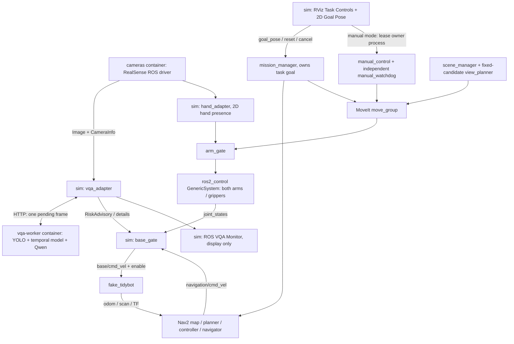

# 系統架構、RViz 操作與功能整合指南

目前可以用 **RViz UI 操作底盤導航和手臂**，不用每次手動發 ROS goal。第一次啟動／切換模式仍從宿主終端執行 Make；啟動後使用 RViz 的 Retail Task Controls 與 MoveIt Motion Planning 面板。

想看截圖中每一個選項，請讀 [RViz 視角與 MoveIt 欄位逐項說明](RVIZ_MOVEIT_GUIDE.md)。

目前：真 RealSense RGB／真 YOLO-assisted VQA、Nav2 假底盤、OpenArm 假手臂。真機馬達、Isaac、MASt3R 校尺度融合尚未在本系統驗收。地圖是示範地圖，不是相機自動建出的房間。

## 1. 畫面上每一個入口做什麼

| 看見的入口 | 功能 | 使用時機 |
|---|---|---|
| **View: Navigation (top)**／**View: Arm (3D)** | 一鍵切換地圖俯視／看手臂的 Orbit 視角，不改控制模式 | 兩模式都可用 |
| 上方 **2D Goal Pose** | 拖曳導航終點與朝向，交給任務管理器 | 導航模式 |
| **Retail Task Controls** | 模式、任務、閘門、VQA 年齡與原因，以及下列操作按鈕 | 兩模式都顯示 |
| **Nav2: Set goal on map** | 選用同一個 2D Goal Pose 工具，之後在地圖拖曳 | 任務空閒／完成、無 HOLD |
| **Nav2: Reset HOLD (no motion)** | 明確請求重設，後端重新確認觀測／停止／收納；不建立目標 | 排除問題並確認停妥後 |
| **Nav2: Cancel task / HOLD** | 取消目前任務、禁動並維持 HOLD | 要停止導航時 |
| **MoveIt Motion Planning** | 選關節群組、設定目標、規劃、預覽、執行 | 兩模式都顯示；手動執行限 MoveIt 模式 |
| **MoveIt: Arm execution window (15 s)** | 啟動既有 manual_control，取得唯一 lease、確認停止、更新場景、開執行窗口 | MoveIt 模式 |
| **MoveIt: End window / stop owned motion** | 結束此面板擁有的窗口，撤回許可／要求停止 | 該窗口仍運行時 |
| 獨立 **ROS 2 Monitor** | 真相機、當前 VQA、上一筆有效決策、延遲與 raw 回答；不發運動命令 | VQA UI 模式 |

Nav2 與 MoveIt 的面板／工具都保留可見，但**導航與手動手臂執行分模式**。這是在同一個 sim 服務選擇控制權，不需要再開另一個手臂 container。導航模式仍可 Plan 預覽，直接 Execute 會被後端拒絕。

如果誤關面板，使用 RViz 上方 **Panels → Add New Panel → retail_rviz_plugins/TaskControls** 補回任務面板；MoveIt 用 Displays 的 Add → moveit_rviz_plugin/MotionPlanning。最簡單是關閉 RViz 後，在宿主機 `make rviz` 載入預設配置。

## 2. 完整練習一：在 RViz 操作 Nav2

第一次建議先用合成感知練習，避免把 VQA 推論時效問題混在基本操作裡。

### 啟動（宿主機桌面終端）

```bash
cd /home/lester/obstacle_avoid
# 有未完成任務先在目前 UI 按 Cancel，確認停止
make stop
make nav-demo
```

真相機／真模型測試時，最後一行改成 `make nav-vqa`。它另外開 ROS 2 Monitor，該終端會維持前景 UI；另開終端操作其他命令。

### 點選導航（RViz）

1. 看 Retail Task Controls 的 **MODE: Nav2 mission**。機器人、白色可行走區、黑色障礙、紅色雷射應顯示在地圖。
2. 若 Gate 是 HOLD，先看下方原因。真 VQA 模式需新鮮有效觀測、底盤停止且雙臂收納，排除問題後按 **Reset HOLD**。
3. 「Request accepted」只表示收到重設請求；等待 Task 變 DONE、Gate 不再 HOLD。若又變 HOLD，查看新的原因，不能靠連按重設強行通行。
4. 按 **Nav2: Set goal on map**，或上方 **2D Goal Pose**。
5. 在白色區域按住左鍵，拖曳出箭頭方向，再放開。先選靠近機器人的目標；不要點黑色障礙或地圖外。
6. Task 應經 WAIT_NAV_READY／SELECT_NAV／ENABLE_NAV 進到 NAVIGATE。綠線是 Nav2 計畫，機器人位置跟著 odom 變化。
7. 到點為 DONE，底盤撤回許可。尚未完成時不要連點目標：新目標會拒絕，不會排隊。
8. 中途要停，按 **Cancel task / HOLD**。等回饋停止後，確認原因並 Reset，再給一個新目標；原路徑不會自動重播。

目前 fake_base 提供 map／odom 對齊，不需要 AMCL 的 2D Pose Estimate。RViz 地圖與機器人就是 Nav2 顯示區，沒有另外一個網頁小地圖。

### 不動怎麼判讀

| 畫面狀態 | 意思／下一步 |
|---|---|
| Set goal 灰色 | HOLD、任務未空閒、回饋過期，或目前是手臂模式 |
| Accepted 後 HOLD | 目標收到了，但健康／控制權條件未持續滿足；看 Task reason |
| VQA OBSERVE／DATA_LOSS／STOP | 沒有導航通行建議；不要用上一筆 CONTINUE 當作目前許可 |
| VQA CONTINUE 但 Gate HOLD | 停機鎖仍在，CONTINUE 不會自行釋放 |
| reset 被拒絕 | 尚未確認停妥／收納、觀測失效，或有控制衝突 |
| 有路徑但沒有位移 | 規劃成功不等於取得執行許可；查看 Gate reason 和 odom |

需要完整數字時，宿主 `make shell` 後：

```bash
ros2 run retail_core demo_control status
# 或不用 UI 指定一個新目標並觀看結果
ros2 run retail_core demo_control goto --x 0.6 --y 0.2 --yaw 0 --wait
```

## 3. 完整練習二：在 RViz 操作 MoveIt

### 切換模式（宿主機）

先在目前 UI 取消任務並確認停止，退出舊 container shell，再執行：

```bash
make stop
make moveit
```

這會重建一個獨立的假手臂工作階段。底盤仍是假硬體，這個模式不啟動 Nav2／mission_manager。Retail Task Controls 顯示 **MODE: MoveIt manual**；Nav2 的控制按鈕灰色。

### 設定與執行（全在 RViz）

1. 在 **MoveIt Motion Planning → Planning**，Planning Group 選 `right_arm`，Start State 選 `<current>`。
2. 到 **Joints** 分頁設定右臂目標。第一次可設定 `openarm_right_joint4=0.3 rad`，其他為 0。Goal State `<current>` 表示目標仍等於當前姿態，不改目標就不會有預期位移。
3. 回到 Planning 按 **Plan** 預覽。Plan 成功只是規劃成功，沒有執行許可。
4. 在 Retail Task Controls 按 **MoveIt: Arm execution window (15 s)**。
5. 看面板底部訊息，等待 **GUI execution window: 15 seconds**，才表示 lease／禁動底盤／停止／場景條件已確認。
6. 在窗口內按 **Plan & Execute**，用當前回饋重新規劃並執行。不要拿窗口前的快取路徑直接 Execute。
7. 假手臂應動到目標。窗口結束會撤回許可；底盤仍禁動。
8. 要中止此面板開出的窗口或運動，按 **End window / stop owned motion**，等停止回饋。取消後可能維持 HOLD；假硬體可用宿主 `make moveit` 開新的工作階段，不復送舊軌跡。

回收納姿態時，重新把七軸目標設 0，再開新窗口、Plan & Execute。左臂改選 `left_arm`。這套基線已驗證關節目標；拖曳末端的 IK／可達性仍受上游模型與 solver 設定限制。

按鈕灰色時先看 MODE、Gate reason、停止回饋和是否已有一個窗口；不要同時用另一個 manual_control owner 搶 lease。關閉 RViz 會結束這個面板擁有的手臂窗口；Nav2 任務則不會因關閉 viewer 自動取消。

CLI 對照（宿主 `make shell` 後，在容器）：

```bash
ros2 run retail_core manual_control move --group right_arm --joints 0 0 0 0.3 0 0 0
```

它自動完成取得 lease、場景更新、規劃、執行與撤回許可，不需要再按 Arm window。CLI 與 UI 是兩種入口，不能同時控制。

## 4. VQA 為什麼 DATA_LOSS？現在怎麼延續決策？

最新一次已用實際影片與 raw 回答進一步診斷，並把權重／prompt／來源搬入專案。固定四選項、語法錯誤／語義矛盾／過期的分別見 [VQA_DIAGNOSTICS](VQA_DIAGNOSTICS.md)。

本次實測相機仍約 15 FPS，推論通常約 0.9–1.3 秒。模型使用**影像擷取時間**：一筆結果回來時可能已經 1 秒，再等下一筆 1 秒，就會跨過既有 2 秒有效期。另有回答被原 schema 驗證器拒絕的情況，例如 LOW risk 與理由中的證據不足矛盾。這不全是相機斷訊。

目前做了兩件事：

- 推論完成立即通知 ROS executor，不再等下一個 100 ms timer 才更新／送下一筆。仍是單一有界推論工作，不排隊舊影像。
- VQA UI 保留 **Last valid**，顯示原決策與距今多久。當前失效時，卡片明示 **LAST VALID … (history only)**、**CURRENT: DATA_LOSS — motion denied**，raw 留作 debug。新 STOP／DANGER_WARNING 直接更新，不延後顯示。

**延續的是畫面上的歷史參考，不是過期的移動許可。** `RiskAdvisory.action/valid`、原 capture stamp、2 秒 TTL、來源 epoch 和本機 watchdog 保留。沒有把舊 CONTINUE 重新蓋上 now，也沒有用歷史結果掩蓋新 STOP、失效或來源重啟。

這項排程修正可減少額外延遲，不能保證消除 DATA_LOSS。若推論／模型驗證本身不符合時效，仍會 HOLD；需要實際降低推論延遲／抖動並重新量測，不能單純加長時效。Last valid 旁的年齡不代表新的觀測。

檢查方式：

```bash
# 容器內：唯讀，30 秒後印健康比例、影像 FPS、推論延遲
python3 /workspace/scripts/measure_vqa_health.py --seconds 30
ros2 run retail_core demo_control status
```

## 5. 系統實際架構



mission_manager 與手動 lease owner 按模式互斥。RViz 和 VQA UI 不新增 container。VQA 是建議、任務管理器持有 goal、本機閘門持有運動許可；每個最終控制端只有一個寫入者。

## 6. 每一個程式在哪裡、做什麼

自己的 ROS 原始碼在宿主 `ros2_ws/src`，容器掛載為 `/workspace/ros2_ws/src`。表中相對路徑以 repo 根目錄為準。

| 程式／套件 | 位置 | 主要功能與接口 |
|---|---|---|
| 整合 launch | `retail_bringup/launch/sim.launch.py`（位於 `ros2_ws/src/`） | 合併 robot_description，啟動當前模式；不選真馬達 plugin |
| RealSense launch | `retail_bringup/launch/realsense.launch.py` | 依本機配置啟動相機，Image／CameraInfo |
| 相機／影片模擬來源 | `retail_core/retail_core/camera.py` | fixture 或影片發布成 ROS Image；不與同 topic 真相機同開 |
| VQA adapter | `retail_core/retail_core/vqa.py` | RGB→有界 HTTP→`/perception/vqa/chest`；擷取時間／schema／來源有效性 |
| GPU 推論 | `docker/vqa_worker.py` | 重用鎖定上游的 YOLO／temporal hints／Qwen／constrained decoder，模型唯讀 |
| VQA UI | `retail_core/retail_core/vqa_ui.py`、`vqa_monitor_view.py` | 訂閱 ROS，顯示當前與歷史結果；不發運動命令 |
| 任務管理器 | `retail_core/retail_core/mission.py` | `/mission/goal_pose`、reset/cancel；持有 Nav2／MoveIt goals；取消不重播 |
| 底盤閘門 | `retail_core/retail_core/gate.py`、`policy.py` | VQA／控制仲裁／停止與收納／逾時；唯一 `/base/cmd_vel` 出口 |
| 假底盤 | `retail_core/retail_core/fake_base.py` | 消費 gate 輸出，產生 odom／scan／TF；不是 Isaac 或真底盤 |
| 手臂閘門 | `retail_core/retail_core/arm_gate.py` | MoveIt trajectory 代理、持續許可與取消／停止回饋 |
| 手動控制 | `retail_core/retail_core/manual_control.py` | 手動唯一 lease，場景綁定的新規劃／執行；UI 窗口重用此程式 |
| 手動 watchdog | `retail_core/retail_core/manual_watchdog.py` | 獨立監看 lease 心跳，失聯撤回許可、取消 goal、HOLD |
| 手部感知 | `retail_core/retail_core/hands.py` | MediaPipe RGB 2D hand detection／ObstacleState；未知與空觀測分開 |
| 場景 | `retail_core/retail_core/scene.py` | 已知貨架 fixture、scene revision、PlanningScene；外部 metric scene 入口 |
| 腕部視角 | `retail_core/retail_core/views.py` | 固定候選關節姿態，MoveIt state validity＋FK 篩選；不是完整未知區域主動探索 |
| 重建 adapter | `retail_core/retail_core/reconstruction.py` | 選用外部 worker，raw submap；未校尺度時維持 metric_valid=false，不授予清空 |
| CLI | `retail_core/retail_core/demo_control.py` | status／goto／cancel／reset／假任務；沒有直接 velocity 發送 |
| RViz 任務面板 | `ros2_ws/src/retail_rviz_plugins/src/controls_panel.cpp` | typed task services、選目標工具、手動窗口子程序，無 raw motor publisher |
| RViz launcher | `scripts/open_rviz.py` → image `/opt/itri/open_rviz.py` | 共用鎖、取得運行中模型、開一個 viewer |
| ROS 訊息／服務 | `ros2_ws/src/retail_interfaces/msg`、`srv` | RiskAdvisory、GateState、SceneState、ManualLease 等 |
| 幾何 | `ros2_ws/src/retail_description` | TidyBot 底盤 mesh／URDF、未校正示範裝配偏移、來源 hash |
| 導航配置 | `ros2_ws/src/retail_bringup/config/nav2.yaml`、`maps/` | Nav2 參數、6×4 m 示範地圖 |
| RViz 配置 | `ros2_ws/src/retail_bringup/rviz/` | 兩種視角都含 Task Controls、2D Goal Pose、Motion Planning |
| 裝置／模型位置 | `.env`、`config/local/cameras.yaml` | 本機掛載、相機序號；不提交 Git |

表中 `retail_core/…`、`retail_bringup/…` 簡寫均位於 `ros2_ws/src/`，不是根目錄另有一份程式。

上游 `external/` 用 dependencies.repos 鎖 SHA。Nav2、MoveIt、ros2_control、RealSense driver 用既有 ROS 套件，不重寫它們；整合修改放 adapters／launch／自己的五個套件。

## 7. 容器、編譯與整合時改哪裡

| 情境 | 宿主命令／修改位置 |
|---|---|
| 使用現有真相機系統 | `make nav-vqa`；3 個容器 sim／cameras／vqa-worker |
| CPU 練習導航 | `make nav-demo`；只需 sim，感知明示 synthetic |
| 手動手臂 | `make moveit`；只需 sim；額外舊 worker 可能仍在背景 |
| 查看／進入 | `make status`、`make shell`；exec 不新增 container |
| 停止 | 先 Cancel／確認停止，退出 shell，宿主 `make stop` |
| 改 ROS 程式／介面／RViz 外掛 | `ros2_ws/src/`；標準 image 用 `make build`，再停止／啟動原模式 |
| 邊改邊編譯 | `make dev` → `make dev-build` → `make dev-restart`，皆在 Docker 內編譯 |
| 改 GPU worker | `docker/vqa_worker.py` 唯讀掛載，需重啟原模式重載；改依賴才 build GPU image |
| 加另一台相機 | 本機相機配置＋唯一序號、topic、TF；也需量測多視角推論時效，不能只加名字當已整合 |
| 接 Isaac | 依 [接口契約](ISAAC_INTERFACE.md)，替換 fake base 回饋來源，不能重複 odom／TF；runtime 暫緩 |
| 接真機 | 需明確硬體 profile、裝配標定、唯一控制出口及停止實測；不能只把 topic 接上便當作完成驗收 |

`make build` 的 Dockerfile 已執行 colcon；標準運行 source `/opt/retail_ws/install`。開發模式 source `/workspace/ros2_ws/install` overlay。宿主 IDE 改檔不會自動修改既有 image 的編譯產物。詳細首次 build、Ctrl+C／Ctrl+D 與退出方式見 [Docker 初學者教學](DOCKER_USAGE.md)。

## 8. 已可用與仍待接通

目前可用：合併模型、純 RGB RealSense、影片 ROS 來源、真 YOLO-assisted VQA、原版 ROS Monitor、Nav2／MoveIt 假硬體閉環、本地閘門、手動 lease／watchdog、RViz 任務按鈕與已知貨架／固定候選視角測試。

仍待驗證：MASt3R runtime／公尺尺度與融合、由重建缺漏驅動的完整主動補拍、當前手部的可信即時 3D 深度與可行繞行、真機馬達／安全停止、Thor 多機部署、Isaac bridge。不能用靜態背景替現在的人手補深度，也不能把未知或過期障礙當成清空。
