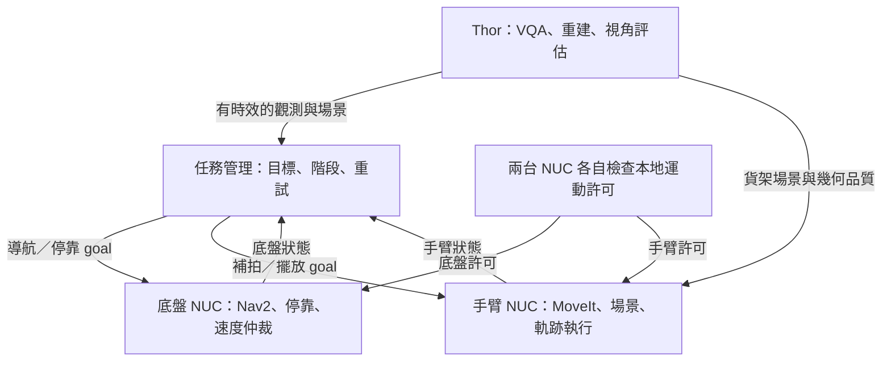
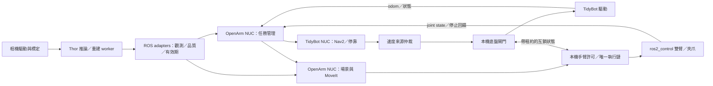

# ITRI 便利商店機器人系統設計書

OpenArm × TidyBot × NVIDIA Jetson AGX Thor｜v0.5 RealSense／VQA 整合基線｜2026-11-10

已建立 ROS 2 相機／VQA／手部 adapters、Nav2 假底盤、MoveIt／雙臂 fake hardware、兩個本地閘門、場景／候選視角與任務管理，並完成隔離的固定目標任務閉環。實際模型回放與實測邊界見 [integration 驗收](validation/2026-11-10-integration.md)，操作見 [README](../README.md)。D435 純 RGB → VQA → RViz 已完成本機擷取與斷流驗收，見 [相機驗收](validation/2026-11-10-realsense-vqa.md)。真機運動、Thor、MASt3R 尺度／融合與真人共域尚未驗收。

本輪把小型整合節點先集中於 `retail_core`，共用訊息在 `retail_interfaces`，配置／launch 在 `retail_bringup`；下面按功能命名的六套件仍是未來拆分提案。不要把目錄提案當成已存在的套件。實際目錄與 Docker 開發 overlay 見 [專案配置](PROJECT_LAYOUT.md)。

## 1. 系統目標與第一版範圍

把底盤導航、停靠、貨架重建與商品擺放接成一條任務。第一版以一個貨架、一個已知商品、一個擺放位置做驗證。先假定商品已在右手夾爪中，右手負責擺放，左手帶腕部相機補視角，補拍後回到已知收納姿勢。此分工可依實際裝配調整。導航時雙臂收好，停靠並鎖定底盤後才開始掃描與擺放。第一版不做底盤與手臂同步運動。

| 範圍 | 第一版 | 後續 |
|---|---|---|
| 導航 | 已知停靠點跑通，再接語言定位。左肩、胸口、右肩影像做視覺問答（VQA） | 多貨架服務、繞道與多視角判斷評估 |
| 貨架幾何 | 已知貨架模型與固定格位驗證擺放。獨立驗證胸口重建，再接左腕補拍 | 多格位選擇、未知貨架與更多補拍視角 |
| 擺放 | 貨架位姿與預設格位提供目標。MoveIt 2 規劃接近、放置、退回 | 商品位姿辨識、抓取、擺放驗證擴充 |
| 動態障礙 | 進入操作區即暫停。確認停妥、障礙清除、更新場景後再規劃 | 有可信即時三維量測時，在模擬及隔離測試驗證繞行 |

**計畫驗收與工程擴充分開。** 計畫書第 8–10、17–18 頁涵蓋語言→影像提示點→三維目標→導航、動態避障、停靠與操作對準、AGX 部署與量化驗證。第 9 頁及附件 B 期中條文有純 RGB 要求。已知停靠點與預先給定貨架位姿是工程基線，完整驗收仍需串接語意定位。MASt3R-SLAM、左腕主動補視角與商品擺放是本次整合設計。若實驗室加入 RGB-D、光達或獨立防護設備，按 `pure_rgb` 與擴充 profile 分開記錄與驗收，純 RGB 研究結果單獨呈現，場域防護需求另外評估。期末交付日期為 115.11.30（2026-11-30）。

## 2. 現有 GitHub 程式的接法

下表是本次查閱的上游快照。P0 須比較實機 checkout 與本表，再建立實際使用的鎖定版本。

| Repo／快照 | 已確認 | 建議接點 |
|---|---|---|
| [OpenArm `main`](https://github.com/hrc-pme/openarm_dev/commit/3eaa3361d84866394ff5fa9865514aed80af4833) | Humble 容器。`openarm_bringup` 有雙臂 fake hardware，預設選左右 `joint_trajectory_controller`。目前 HEAD 也有 Unity 遙操作路徑。 | 先用 fake hardware 核對 URDF/SRDF、關節回饋、左右臂 trajectory action 與取消／停止。專案外層只接核對過的標準 action。整合啟動檔讓 MoveIt 執行端獨占軌跡入口。 [README](https://github.com/hrc-pme/openarm_dev/blob/3eaa3361d84866394ff5fa9865514aed80af4833/README.md) · [Bringup](https://github.com/hrc-pme/openarm_dev/blob/3eaa3361d84866394ff5fa9865514aed80af4833/ros2_ws/src/openarm_ros2/openarm_bringup/launch/openarm.bimanual.launch.py) |
| [避障 `main`](https://github.com/Laiting20021202/social-safety-decision/commit/783b5d986487cd66b3e6f333875c631bbe0f9b64) | 有 RGB-D 人手感知、`openarm_safety_bridge`、`openarm_dynamic_avoidance` 與 Gazebo 歷史整合。Isaac 手部避障閉環仍待驗收。另有隔離 Isaac 底盤退避實驗。 | 先抽接手部觀測、風險狀態與測試案例。Gazebo 紀錄可作回歸基線，Isaac viewer／`/joint_command` 需另接 trajectory action。底盤退避僅保留為模擬對照。 [Isaac 交接](https://github.com/Laiting20021202/social-safety-decision/blob/783b5d986487cd66b3e6f333875c631bbe0f9b64/docs/ISAAC_SIM_HANDOFF.md) · [退避紀錄](https://github.com/Laiting20021202/social-safety-decision/blob/783b5d986487cd66b3e6f333875c631bbe0f9b64/results/tidybot_retreat_2026-09-30.md) |
| [VQA `LesterVQA`](https://github.com/LesterLiou/VLMotion_VQA/commit/889558ff0ff5f43c818ce82aa39b7b95734e7e6e) | ConvLSTM＋Qwen 整合模型目前主要是影片 UI。既有 ROS 相機入口對應 YOLO／SAM3 研究路徑。整合模型 schema 有 `STOP`、`DANGER_WARNING`、`CONTINUE`、`OBSERVE`，另有健康層 `DATA_LOSS`。 | 重用無介面推論核心、既有 prompt/schema 與驗證器，新增 ROS Image adapter。三視角融合放在模型外，模型權重與基準路徑各自保存。 [README](https://github.com/LesterLiou/VLMotion_VQA/blob/889558ff0ff5f43c818ce82aa39b7b95734e7e6e/README.md) · [介面](https://github.com/LesterLiou/VLMotion_VQA/blob/889558ff0ff5f43c818ce82aa39b7b95734e7e6e/ros2_ws/src/lightweight_risk_vqa/docs/INTERFACES.md) |
| [TidyBot `main`](https://github.com/Li-ChengWang/tidybot_ros2_control/commit/207f07fd91a1cefc811f4237eebac57827b2735b) | 文件提供 Humble 原生安裝與已驗證的 Jazzy 容器。現有 `/cmd_vel`、`/tidybot/enable`、`/tidybot/control_frame` 與 `/odom`，並有 D415／ArUco 對接和 mux。 | 重用底層驅動與對接。查明各入口訊息型別、座標、手把優先權與 watchdog。Nav2 速度先交既有或擴充的 mux，最後由底盤 NUC 上唯一出口送至驅動。 [底盤介面](https://github.com/Li-ChengWang/tidybot_ros2_control/blob/207f07fd91a1cefc811f4237eebac57827b2735b/ROS2_CONTROL.md) · [對接](https://github.com/Li-ChengWang/tidybot_ros2_control/blob/207f07fd91a1cefc811f4237eebac57827b2735b/DOCKING.md) · [容器](https://github.com/Li-ChengWang/tidybot_ros2_control/blob/207f07fd91a1cefc811f4237eebac57827b2735b/DOCKER.md) |

本次重新查證：前三個 repo 的 SHA 與上表相同，TidyBot HEAD 已為 `195a46e5770e56ac35fb7fa437bb7fbad7d434b1`，新增 battery monitoring；整合來源清單採新 SHA。避障 repo 已有 `realtime_safety/pipeline/mast3r_slam_adapter.py` 與 worker，優先重用。其安裝腳本仍會 clone 未鎖 SHA 的公開 MASt3R-SLAM；實驗室實際 checkout、checkpoint、ROS 包裝及校正結果尚待確認。完整接點與來源見 [BASELINE](BASELINE.md)、[DEPENDENCIES](DEPENDENCIES.md)。

上方快照表保留既有設計依據。第一節既有計畫書頁碼、條文及交期未附原始文件，本次沒有查證，需由團隊核對後才列為已確認驗收要求。

## 3. ROS 2 分工與任務時序



| 主機 | 常駐元件 | 與其他主機的邊界 |
|---|---|---|
| TidyBot NUC | 底盤 CAN／里程計、Nav2 與定位、ArUco 對接、手把仲裁、速度閘門與本地逾時 | 收導航／停靠目標、風險提示、手臂收納與心跳。回傳 odom、靜止確認、狀態與運動鎖 |
| OpenArm NUC | OpenArm CAN、雙臂 `ros2_control`、MoveIt 2、夾爪、手臂本地運動閘門。任務管理器第一版也放這台，作為獨立程序 | 收停靠／底盤鎖、場景與障礙狀態。回傳收納、執行、停止與夾爪狀態 |
| AGX Thor | VQA、MASt3R-SLAM、點雲整理、手部偵測及視角評估。以 ROS adapter 交付結果 | 收所需影像與機器人狀態。輸出帶時間戳與品質的資料。CUDA 推論／重建在獨立程序，GPU 掛起時由本地閘門按逾時處理 |

相機驅動放在 USB／相機實際連接的主機，每台相機只有一個擷取者。肩／胸相機若接 OpenArm NUC，該機發布影像與內參，Thor 訂閱；左腕相機同樣附上擷取時腕部 TF。若相機直接接 Thor，只搬移擷取程序，不搬動本機運動閘門。實際接線、序號與 topic 都由配置選擇。

部署時的控制鏈為：



閘門是必要的本地功能，不表示只在 MoveIt 前加一個轉發器便可保證停止。手臂執行期間仍需持續監看許可，並有已驗證的 controller 停止路徑；底盤速度與 enable 的最後出口由同一鏈管理，禁止其他 publisher 繞過。這些是 P1 起待實作和驗收的控制要求。

任務順序為 `IDLE → NAVIGATE → DOCK → VERIFY_STANDSTILL → SCAN_SHELF → SUPPLEMENT_VIEW（有需要時）→ PLAN_PLACE → EXECUTE_PLACE → RETRACT → DONE`。活動階段可進入 `HOLD` 或 `FAULT`。任務管理器每次只發一組互斥的子任務，保留 `mission_id`、goal ID、場景 revision 及逾時原因。離開服務點以前須確認雙臂收納。任務取消先收回許可，再等待子 action 結束及實際停止回饋。重開、失聯或狀態不一致時兩邊都禁止新運動，重新握手、校驗與授權後才開始新目標。

- **底盤許可**須有當前模式、手臂收納、健康狀態與單一速度來源。Nav2、停靠、手把各用自己的輸入。停靠交接先取消導航並確認停止，再切換控制權。以底盤座標保留 TidyBot 橫移 `vy`，核對 Nav2 設定與 `Twist`／`TwistStamped` 邊界。
- **手臂許可**須有當前模式、底盤運動抑制有效、odom 與回饋支持已連續靜止、控制器就緒、TF 及場景有效。工作中持續監看底盤，失去鎖定或狀態過期即請求停止。兩個閘門都用本地時鐘看心跳是否過期，不從另一台主機的單一布林值推定靜止。
- `HOLD` 要驗證控制器取消後的停止行為，保留適當的夾爪狀態。`FAULT` 收回許可並要求依故障程序復歸。實體急停與所需的獨立防護依整機風險評估及實際硬體驗證，應可在 ROS、Thor 或網路故障時生效。Nav2 Collision Monitor 若使用，屬軟體附加防護。 [Nav2 Collision Monitor](https://docs.nav2.org/jazzy/configuration_and_development/configuration_guide/core_servers/collision_monitor/configuring_collision_monitor_node/) · [OSHA 機器人系統防護參考](https://www.osha.gov/otm/section-4-safety-hazards/chapter-4)

## 4. 導航與三視角視覺問答

1. **目標支線**由自然語言接地模組提供相機 ID、像素提示點與擷取時間。已知地面可做射線與地平面交會，已知貨架可用標定過的貨架平面或標記位姿，多視角則須通過匹配、基線與重投影檢核。內參反投影得到視線方向，還需要平面交點、可靠深度或三角化才有公尺尺度。將結果轉成含方向、停靠距離與可通行性檢查的候選 `PoseStamped`。
2. **運動支線**由 Nav2 在地圖及當前幾何障礙資料上規劃。先證明底盤有可靠定位及障礙來源，VQA 無法補足缺少的局部可通行幾何。純 RGB 受控情境先用已知地圖、里程計／可用定位來源及經驗證的視覺幾何觀測。第一個可驗證的動態障礙 adapter 可用行人接地點與標定地平面交會，再依定位誤差、可見性與時效建立保守的局部佔用。足部被遮蔽或幾何無效時依模式等待。Nav2 footprint 納入載台、貨物與收納姿態外廓，測試含全向橫移的可通行性。遇通道阻塞可由任務層要求 Nav2 重規劃。沒有可行路徑時等待或中止。
3. **VQA 支線**第一步用胸口相機跑通無介面推論。再加入左／右肩。每台相機維護各自的時間序列與模型記憶，資源允許時共用權重而分開狀態。以時間窗對齊有效輸出，保存視角、時間、原始答案與證據。避免三視角多數決蓋過單一可信的危險線索。未覆蓋路徑或視角斷流要反映成可見性不足。側視角的「朝相機靠近」需結合相機朝向與行進方向才能判斷是否影響底盤路徑。

| 融合後提示 | 任務層建議 |
|---|---|
| `STOP` | 提出暫停，保留證據。後續 `CONTINUE` 無權解除暫停。 |
| `DANGER_WARNING` | 可要求降速、等待或重評候選路徑。降速後能否移動仍由幾何資料與底盤許可決定。 |
| `CONTINUE` | 維持原計畫。所有必要幾何與運動許可仍須有效。 |
| `NO_DETECT` | 只表示來源明確回報有效觀測且無相關目標。不能從空字串、timeout 或沒證據推導。某些舊路徑有 `NO_RESPONSE`，需先查明其空場語意。 |
| `OBSERVE`／`DATA_LOSS` | 前者為觀測不足以判斷，後者為必要輸入／輸出不可用。必需覆蓋不足時保持或暫停。可選側視角失效可保留診斷，須先證明其餘視角仍滿足該模式所需覆蓋。 |

VQA 起初只記錄建議與真值對照（shadow mode）。上游型別或標籤與整合契約不同時由 adapter 映射並保留原始值。`no_detcet` 拼字只在確定其來源與語意後列為相容別名。模型的 JSON、短句或信心欄不作直接控制依據。

## 5. 胸口重建、左腕補拍與商品放置

### 胸口主圖和公尺尺度

胸口影像給 MASt3R-SLAM 做貨架背景重建。停靠後胸口相機通常固定，連續重複同視角只會保留同一遮蔽。選擇保留停靠前可用的連續影像與姿態，或在隔離場域依既有許可規劃多視角採集。以貨架標記／已知尺寸與標定過的相機外參求可觀測的尺度及對齊，把重建座標映射到 `shelf_frame` 或 `base_link`。校正與獨立檢查使用不同的量測點。若資料不足以支持尺度或配準，第一版切回已知貨架模型或停在掃描階段。保留 ROI、重建版本、資料擷取區間、追蹤狀態、對齊品質與公尺尺度驗證。地圖優化或重定位造成跳動時更新版本並使舊計畫失效。

### 左腕主動補視角

以胸口主圖和已知貨架幾何建立擺放格位與接近走廊的 ROI。先算哪些面與體積已觀測、哪些被遮住或點密度不足。表面有洞或看不到的體積標為 `unknown`，保留已觀測自由空間與已佔據的區分。左手先從事先驗證的 2–3 個觀測姿勢候選中選，排除碰撞、不可達、觀測方向不佳及阻塞右臂路徑的姿勢，再按預期 ROI 覆蓋增加量與移動成本排序。左腕取得同步影像和腕部位姿後，使用 FK／手眼標定提供的先驗與有重疊的貨架點或標記配準。可採用短序列重建或有基線的匹配三角化。胸口與左腕畫面分開管理，不將左右視角無序塞進同一單眼追蹤序列。融合須同時通過尺度、時間、重疊與誤差檢核。超出補拍預算且關鍵區仍不可見時，回報不可擺放。

### MoveIt 2 的工作

定位模組輸出 `shelf_frame` 下的格位與方向，按商品／夾爪尺寸生成 `pre-place → place → retract`。第一版使用標記或人工量測的貨架位姿與固定格位。MoveIt 2 接收貨架碰撞物、已驗證的幾何障礙、目前關節狀態與目標位姿，規劃及驗證路徑。把夾持中的商品當附著碰撞物，放開後按已知狀態更新場景。保留格位與路徑的保守間隙。Scene revision 或夾爪狀態改變後，依目前實測狀態重新規劃。 [MoveIt Planning Scene](https://moveit.picknik.ai/main/doc/concepts/planning_scene_monitor.html)

## 6. 人手介入與動態避障

**分成靜態貨架場景與即時手部觀測。** 將現在影像中的手部像素投到較早的貨架點雲，射線通常會命中手後方的貨架，得到背景深度。即使點雲本身已校成公尺尺度，這仍無法量到手的位置。MoveIt 應接收有獨立時效與來源的動態障礙，與貨架背景分別更新。

| 當前觀測 | 第一版反應 |
|---|---|
| 手部出現在受控操作區的警戒投影內，只有 2D 或深度不可信 | 發出 `HOLD`，立即撤回執行許可並請求受控停止。覆蓋、時間戳或 TF 失效也依模式暫停。 |
| 有已驗證的同步多視角 RGB 幾何，或研究擴充組有同期對齊 RGB-D | 從同時可見且可對應的點估 3D，或用同期手部遮罩配對深度，檢查有效深度比例、背景混入、尺度、TF 時間與誤差。用保守的 3D 佔用更新規劃場景。手在操作區時維持暫停。 |
| 停妥且操作區有充分觀測並持續清空 | 更新動態場景、確認底盤與手臂許可。第一版由操作人確認，再從實際關節狀態重規劃或中止。單幀漏檢、逾時或障礙資料消失均不可視為清空。 |

停止鏈須獨立於 MoveIt 規劃返回時間。量測從影像擷取、偵測、停止要求、控制器接收、到實際靜止的時間及停止距離。`cancel` 回應只代表請求處理狀態。若輸入只有一般 RGB 與模型，限制在具物理隔離的開發驗證，以假手、假障礙或模擬測試。真人共域或障礙旁繞行由場域風險評估、獨立防護與實機測試決定。 [MoveIt 感知管線](https://moveit.picknik.ai/humble/doc/examples/perception_pipeline/perception_pipeline_tutorial.html) · [OSHA 機器人系統防護參考](https://www.osha.gov/otm/section-4-safety-hazards/chapter-4)

## 7. 介面、TF 與資料生命週期

以下是**整合層提案**。上游實際 topic、型別、QoS 與 action 名稱由 P0 查證，放在 `config/remaps/` 與 `docs/BASELINE.md`。以 adapter 做轉換，保留原始控制端點在本機。名稱可用機器人 namespace 加前綴。

| 介面 | 型別／最小資料 | 生命週期 |
|---|---|---|
| `/perception/cameras/{left_shoulder,chest,right_shoulder,left_wrist}/…` | `Image`／`CompressedImage`、`CameraInfo`。擷取時間、光學 frame、標定版本 | Sensor Data QoS 起步，核對 publisher/subscriber 相容。每路有缺流及影像年齡診斷。 |
| `/perception/vqa/advisory` | 建議 `RiskAdvisory`。擷取時間窗、推論結束時間、來源視角、觀測健康、建議 enum、理由／證據、模型與 prompt 版本 | 保留每個視角的有效期與原始輸出。辨別回播、重啟與跳時。 |
| `/perception/shelf/scene` | `PointCloud2`／貨架 `PoseStamped` ＋配對的場景中繼資料。revision、覆蓋、尺度品質、擷取範圍 | 視覺化點雲可降採樣。供規劃的場景及版本須配對且經檢核。 |
| `/perception/dynamic_obstacles` | 建議 typed 觀測。2D mask/bbox 或可選公尺尺度 3D 幾何、誤差、是否可見、來源與時間戳 | 有效期屆滿標為未知。清空須由新的有效觀測確認。 |
| `/mission/execute`、底盤導航、手臂執行 | 任務 action。以 `NavigateToPose`、上游對接、MoveIt／`FollowJointTrajectory` 連接 | goal/cancel/feedback/result 與任務 ID 綁定。不重送上一輪軌跡。 |
| 底盤速度輸入與最終出口 | 各控制來源→mux→本機閘門→驅動。型別以實際發行版／上游程式為準 | 本機 watchdog 驗證最後有效命令、擁有者、模式與啟用。預設停用。 |

- **TF** 採 `map → odom → base_link → arm_base_link`。固定肩／胸相機外參和左腕 `tool → camera_optical_frame` 屬機器人描述。腕部位姿來自擷取時的關節回饋及 FK。`map→odom` 只由定位來源提供，`odom→base_link` 只由底盤里程計或選定融合節點提供。MASt3R-SLAM 子地圖使用獨立座標，對齊後才進規劃場景。`shelf_frame` 依場域標記或選定估計器建立，避免重複發布。 [ROS REP 105](https://www.ros.org/reps/rep-0105.html)
- **時間** 三機走有線網路與時鐘同步，量測實際偏移。影像、深度、關節與 TF 依擷取時間配對。缺 TF 或超出配對容許區間即拒絕。跨機觀測用資料時間戳判斷新鮮度，本機 watchdog 用單調時鐘判斷接收逾時。回放／模擬全域一致使用 `/clock` 與 `use_sim_time`，與真機網路或 ROS graph 隔離。設定單一 ROS 2 發行版、`ROS_DOMAIN_ID` 與 RMW，先做三機 discovery、QoS、action cancel、`/tf_static` 及斷流檢查。Domain ID 用於隔離開發環境，實機隔離還應靠網路與硬體設定。 [ROS 2 QoS](https://github.com/ros2/ros2_documentation/blob/jazzy/source/Concepts/Intermediate/About-Quality-of-Service-Settings.rst)
- **效能** 640×480 RGB8、15 Hz 的四路未壓縮影像約 55.3 MB/s（442 Mb/s，未計傳輸開銷）。按階段訂閱與限頻，優先保留手部監看、狀態和控制路徑。胸口與左腕按重建需要發送，VQA 用有界佇列與時間窗。共用 GPU 時量測同時負載下的延遲尾端，讓重建限流與低優先權任務讓出資源。

## 8. Repo、容器與部署配置

**Docker 是必備交付。** 開發、假硬體測試與三機部署均以 Docker Compose 作為標準入口。起始包的 `Dockerfile`、`compose.yaml` 與 `docker/ros_smoke.py` 可用於驗證容器中的 ROS 2 訊息收發。第一個功能里程碑須能在 CPU 容器內重跑假硬體閉環。正式部署再依各主機工作負載建立映像。 [建置與驗收](DOCKER.md)

目前提供 `ros-smoke`、非 root `dev`、離線 `dev-check`、已編譯的 `sim` 與選用 `vqa-worker`；整合映像含 Humble、MoveIt 2、Nav2、RealSense 與 ros2_control。真機運動與 Thor service 仍須依主機驗收後實作。共用 Dockerfile／ROS 介面與建置規則，兩個 NUC 使用各自的運行映像；Thor 的 ARM64 GPU 映像依實機 JetPack 選擇，不直接套用 x86 開發映像。

**一個整合 repo，加上上游版本清單。** 自己維護的 ROS 2 套件先放同一 repo。外部程式用 `dependencies.repos` 與 `vcs import` 拉取鎖定 SHA。把被選的套件匯入各主機工作區或建立各自 overlay，避免直接掃進巢狀工作區、測試用重複套件及整套研究原型。Git submodule 留給需要在整合 repo 中管理的 fork 或無法以獨立套件組裝的來源。大型權重、模型快取、實驗 rosbag 與本機校正使用獨立路徑，記錄版本／雜湊。整合 repo 的建議結構如下。

```text
itri_retail_robot/
  AGENTS.md
  CODEX_PROMPTS.md
  docker/Dockerfile                # 正式 Docker 定義；實際結構見 PROJECT_LAYOUT
  compose.yaml                     # include 入口
  Makefile
  .dockerignore
  docker/ros_smoke.py
  docs/DOCKER.md
  docs/SYSTEM_DESIGN.md
  docs/BASELINE.md                  # 已建立，保留待驗證欄
  docs/DEPENDENCIES.md              # 來源取得及套件選集
  prompts/vqa_nav_advisory_v1.md
  dependencies.repos               # 已鎖四個來源 SHA
  external/                        # 上游來源，不納入整合 Git
  config/{profiles,remaps,calibration}/
  deploy/{base_nuc,arm_nuc,thor}/
  ros2_ws/src/
    retail_interfaces/
    retail_bringup/
    retail_mission/
    retail_navigation/
    retail_manipulation/
    retail_perception/
```

**共用建置方式，依主機發佈映像。** 以 x86 NUC 的共用 ROS 基底映像派生 `base-nuc`、`arm-nuc`，各自只帶所需套件與設備權限。Thor 使用符合實機 JetPack／Jetson Linux 版本的 ARM64 CUDA worker 映像。CAN 驅動、設備命名與 udev 由宿主機配置。上游容器範例中的全權模式不直接沿用。CI 優先驗證建置、假硬體與小型回放，真機啟動使用獨立設定及明確授權。 [NVIDIA Thor 容器說明](https://docs.nvidia.com/jetson/agx-thor-devkit/user-guide/latest/setup_cuda.html)

整合套件按責任拆分，先留在同一整合 repo，等介面與發版週期穩定才考慮拆 repo：

| 建議套件 | 責任／擁有者 | 首次實作階段 |
|---|---|---|
| `retail_bringup` | Compose 對應的 launch、profile、remap、機器人裝配與參數載入；不含推論模型 | P1a fake bringup |
| `retail_mission` | 子任務 action、模式切換、取消、HOLD／FAULT、mission ID；OpenArm NUC | P1b 最小任務閉環 |
| `retail_navigation` | 導航／停靠 adapter、速度仲裁接點與底盤本地許可；TidyBot NUC | P1b mock 互鎖，P2 接導航 |
| `retail_manipulation` | 場景 revision、擺放目標、雙臂互斥、底盤靜止檢查、唯一手臂執行鏈；OpenArm NUC | P1b 已知貨架與格位 |
| `retail_perception` | VQA、手部、重建、覆蓋與候選視角的 ROS adapters；Thor 為主，worker 保留原核心 | P2 VQA，P3 重建／補拍，P4 動態資料 |
| `retail_interfaces` | 標準型別不足且有兩端消費時才新增 RiskAdvisory／scene metadata／任務契約 | 隨消費端一起加入，不先造整套空訊息 |

程式碼拆套件不代表一套件一容器。兩個 NUC 各用符合角色的運行映像，關聯節點可在同容器不同程序；Thor 的 GPU worker 按 CUDA／Python 相依拆環境，ROS adapter 負責跨機契約。CI／開發使用工具較完整的 dev 映像，部署映像再縮小。

| 選項 | 何時採用 |
|---|---|
| **整合基線先統一 Humble** | OpenArm 與避障流程已有 Humble。先在 TidyBot 驗證其 Humble 路徑。Thor 以 ARM64 Humble adapter 參與 ROS graph，GPU worker 按實機 JetPack 環境執行。可先測 ROS 與 CUDA 共存。若 Python／CUDA 相依不合，以本機 IPC 隔離，讓 ROS adapter 管 topic，worker 管推論。需驗證兩端 Python、影像傳輸、錯誤處理與延遲。 |
| **全系統 Jazzy** | 若 TidyBot 實機只能穩定使用現有 Jazzy 設定，或團隊選擇 24.04 做新基線，先在 OpenArm fake hardware／MoveIt、避障與 Thor 模型各完成 Jazzy 的乾淨建置及回放，再切換。過渡期若必須跨發行版，採獨立 graph 與狹窄的顯式橋接並驗證，控制 graph 預設以同一發行版部署。 |

## 9. 開發順序、通過條件與紀錄

| 階段 | 優先做的事 | 通過條件 |
|---|---|---|
| P0 查證 | 四個 repo、MASt3R 包裝、三台主機與 Docker 版本、四台相機、既有控制端點及可用測資 | 產出有來源的 `docs/BASELINE.md` 並記錄 Compose smoke 結果。無法確認或未執行的項目列 `待驗證`。 |
| P1 假硬體閉環 | 以 Compose `sim` 服務建置與啟動固定停靠點、假底盤、OpenArm fake hardware 與貨架模型 | 從乾淨 checkout 可在容器內完成導航→停妥→鎖定→擺放→收回。雙邊互鎖。取消、重啟、失聯與重複控制來源皆停止或維持禁動。 |
| P2 導航與 VQA | 接實際底盤 adapter／ArUco。先單視角再三視角 VQA。平行驗證語言提示點到幾何目標 | 先錄包 shadow 評估，再在隔離條件接 advisory。驗證過期、遮擋、側視角歧義與阻路重規劃。 |
| P3 靜態貨架 | 接胸口重建與公尺尺度，先離線驗證，再加入左腕補拍、配準和覆蓋檢查 | 同一貨架報補拍前後 ROI 覆蓋、配準誤差、停靠誤差及規劃／擺放結果。故意移除校正或有效 TF 時阻擋擺放。 |
| P4 動態介入 | 假手進場、短暫遮擋、相機斷流、停靠失效、GPU 壓力、操作人復歸 | 驗證實際停妥、無自動續跑、只使用新場景重規劃。隔離低速硬體試驗須先確認獨立停止措施與停止距離。 |

每個階段保存 repo SHA、映像 digest、模型／標定版本、配置、rosbag、場景 ID 和失敗理由。基本量測包含語意與 3D 目標誤差、停靠姿態誤差、導航／擺放成功率（含分母）、最小距離、任務時間、重建覆蓋率、VQA 結果與過期率、各管線延遲 P50／P95、停妥時間與距離。控制逾時、速度、間隙及覆蓋門檻按實機量測與驗收需求確認，這份設計未宣告任何實機性能數字。
