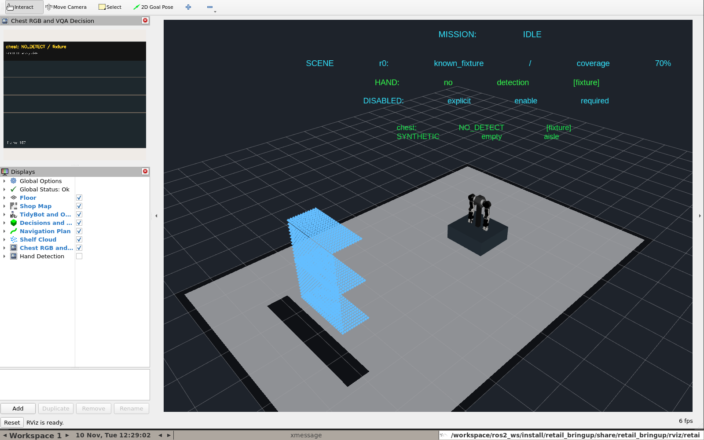

# Docker 使用／開發與 RViz shell 驗收

日期：2026-11-10。整合 HEAD：`d01fae544ae0961335484d71a8d47d9f3b5a8a54`，含既有與本輪未提交修改。四個 `external` checkout 的 HEAD 與 `dependencies.repos` 相符，工作樹乾淨；未修改上游或模型。

## 問題與修正

原本 Xvfb／RViz 已由 `run_sim.bash` 啟動，但該程序的 `export DISPLAY` 不會傳給之後的 `docker compose exec sim bash`。因此互動 shell 手動啟動 RViz 時無法連上顯示器。

本輪將 `DISPLAY=:99`、`LIBGL_ALWAYS_SOFTWARE=1`、`QT_X11_NO_MITSHM=1` 放入 sim 的 Compose environment，重新建立容器後所有 exec 程序共用同一桌面。新增 `compose.dev.yaml`：同一 sim 工作區可寫、載入容器內 colcon overlay；標準 Compose 保留唯讀掛載與映像版本。新增 Makefile，操作與實際目錄見 [README](../../README.md) 及 [專案配置](../PROJECT_LAYOUT.md)。

獨立 `dev` 工具鏈不具 sim 上游 underlay，因此配置 `RETAIL_BAKED_ONLY=1`，避免載入依賴 `/opt/retail_ws/install` 的整合 overlay。初次檢查發現本機 dev tag 的 setup 腳本過期，已 `docker compose build dev` 更新並重新驗收。

## 映像與配置

| 映像 | 本次實際 image ID |
|---|---|
| humble-dev | `sha256:c35b800cbd12314c899d6e555b2607967e7258ff0e2df6aa2dec44f0670f0365` |
| humble-sim | `sha256:8dbe06dc3242c56f5f6957bde6999f87430631e5f6f7529374ab1ea1cb577abb` |

sim 本輪無 ROS 原始碼或 Dockerfile 修改，使用既有已編譯映像；新增功能為 runtime 配置與開發 overlay，三個整合套件已在該容器中重新編譯。ROS 2 Humble／Python 3.10.12／Cyclone DDS，非 root UID/GID 1001，domain 83、localhost DDS。CPU fixture、synthetic chest 相機、GenericSystem 假手臂、假底盤。未映射實體設備或 host network。開發配置保留影片唯讀掛載，只替換 `/workspace` 為可寫。

## 實際執行

| 檢查 | 結果與證據 |
|---|---|
| 標準／開發 Compose config | `docker compose config --quiet`、合併 config 驗證成功；開發模式 `RETAIL_BAKED_ONLY=0`，工作目錄 `/workspace/ros2_ws` |
| 互動標準 shell | 實際執行 `make up`、`make shell`；DISPLAY `:99`、ROS `humble`、模式 `1`、retail_core prefix `/opt/retail_ws/install/retail_core`；`xdpyinfo` 成功 |
| 互動開發 shell | 實際執行 `make dev`；模式 `0`、retail_core prefix `/workspace/ros2_ws/install/retail_core`；原始碼可寫、`xdpyinfo` 成功 |
| Docker 內整合編譯 | `make dev-build` exit 0；3 packages finished [4.87s]；[colcon 實際輸出](2026-11-10-docker-workflow-build.log) |
| 載入 overlay | `make dev-restart` 成功；三個 package share 皆來自 `/workspace/ros2_ws/install` |
| 從 exec 手動開 RViz | `bash -ic` 裡直接執行 `rviz2 -d <retail.rviz>`；程序存活、建立 X 視窗，未出現 display 連線錯誤；noVNC HTTP 200；[輸出](2026-11-10-docker-workflow-gui.log) |
| 開發 overlay 全任務 | `python3 /workspace/scripts/accept_sim.py full` exit 0；Nav2 → MoveIt → 雙臂／夾爪 → 放置／退回完成，DONE，底盤禁動；x=2.0410998601330834；[輸出](2026-11-10-docker-workflow-full.log) |
| 獨立工具鏈 | 重建後 `docker compose run --rm dev-check` exit 0；ROS 收發與非 root CMake／colcon 成功，沒有缺失 sim underlay 提示；[輸出](2026-11-10-docker-workflow-toolchain.log) |
| 最終開發狀態 | `accept_sim.py restart` 驗證 IDLE、實測收納／靜止、禁動、沒有重播 goal；[輸出](2026-11-10-docker-workflow-final.log) |
| 靜態檢查 | `make help`／dry run、`bash -n`、`git diff --check` 通過 |

目前留下可進入的開發 sim 與常駐 dev 工具容器，瀏覽器桌面 `http://localhost:6080/vnc.html?autoconnect=1&resize=scale`。已退出驗收用的額外互動 shell。實際桌面截圖：

## 邊界

RViz 啟動仍有既有 OpenArm 手指 inertia 與軟體渲染 shader 訊息。額外 RViz 測試實例在以 SIGTERM 結束時記錄 `std::system_error: Invalid argument`；這個關閉例外尚未修正。原本由 sim 啟動的 RViz 持續運行，本次修正驗收的是 exec shell 的顯示環境與啟動。非 TTY 的 `bash -ic` 測試會顯示 job control 提示，真正互動 `make shell`／`make dev` 無此問題。

本輪未改控制邏輯、模型或防護參數，未重跑所有先前故障／GPU 案例；其歷史結果見 [整合驗收](2026-11-10-integration.md)。本輪沒有進行 RealSense 實體擷取、馬達控制、Thor 或 MASt3R 尺度／融合驗收。

目錄整理以明確入口、實際配置文件與生成物忽略規則完成。保留既有未提交內容、來源、權重與驗收紀錄；沒有執行全域 Docker 清理。此修正的配置雜湊另存 [source manifest](2026-11-10-docker-workflow-source.sha256)，不覆寫前一階段快照。
