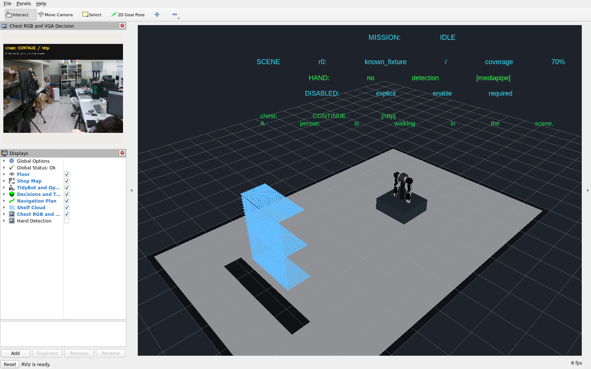

# 本機 RViz 與虛擬桌面移除驗收

日期：2026-11-10（Asia/Taipei）。起始 HEAD `02ef194c0de4a4159965ee1596fef275e9682433`；起始已有 README 修改及 RealSense 最終證據，均保留。未改上游、模型、運動介面或防護參數，未 commit／push。

## 實作

- 從 Dockerfile 移除 Xvfb、VNC、網頁桌面及視窗管理器套件，重建 dev／sim；run_sim.bash 只執行 ROS launch，依配置直接開本機 RViz 或不開視窗。
- 移除桌面 port、固定 DISPLAY `:99` 與 RVIZ_BROWSER 設定。現在 sim 沒有任何發布到宿主的 port，無虛擬桌面程序。
- `docker/compose.local.yaml` 使用宿主 DISPLAY，唯讀掛載 `/tmp/.X11-unix`，使用專案內忽略的私人授權檔。根 Compose include 共用＋local；Makefile 預設加入 local，`GUI=0` 則只使用不開 GUI 的共用配置。
- `scripts/prepare_gui.py` 只讀取當前 DISPLAY 的 Xauthority 記錄，產生權限 0600 的 `config/local/gui.Xauthority`，不列印 cookie、不修改宿主授權資料庫、不放寬 xhost。登入桌面後的 `make up`／`make dev`／`make vqa`／`make vqa-dev` 會自動準備授權。
- 無顯示器的 CPU 驗收腳本使用共用 Compose，不掛 X11 socket。截圖改為只擷取 RViz 應用視窗，不擷取整個本機桌面。
- README 第 7 節逐一說明根入口、共用、local、dev、vqa、realsense、vqa-build、mast3r 的用途與完整命令；維持 Docker 內開發、編譯與使用。

授權轉接使用 [X.Org xauth 的 nlist／nmerge](https://xorg.freedesktop.org/releases/X11R7.5/doc/man/man1/xauth.1.html)，保留當前 display／cookie，調整 family 以支援容器 hostname。授權檔沒有納入 Git 或驗收 log。

## 本次環境與映像

| 項目 | 實際結果 |
|---|---|
| 宿主桌面 | Ubuntu X11，DISPLAY `:1`；`xdpyinfo` 可連線 |
| humble-dev | `sha256:a14183af4e633c29e13886891f453a05ae7fa8d74d825b93e8c339cc7104b05b` |
| humble-sim | `sha256:6dcdbc48bab72d661abb98b815adfcfdbff8b466a762189a04caa730829ea50d` |
| RViz 套件 | `11.2.29-1jammy.20260916.003100` |
| OpenGL | Mesa llvmpipe，direct rendering，OpenGL 4.5；此次使用軟體渲染 |
| GPU 推論 | 重用既有 vqa-worker；模型／prompt hash 與前階段相同 |

完整 image／套件版本見 [版本](2026-11-10-native-versions.log)。Docker build 成功，sim 建置 9 個選定 ROS 套件。dev 與 sim 都更新至不含虛擬桌面套件的新映像；未執行 Docker 全域 prune，也未清理其他專案映像。

## 實際測試與重現

| 指令／檢查 | 結果 |
|---|---|
| `python3 scripts/prepare_gui.py` | 成功準備當前桌面授權；檔案 0600，Git 忽略 |
| DISPLAY 缺失／空的 Xauthority | 正確拒絕；既有可用授權檔未被取代 |
| Docker 內 `xdpyinfo`、`glxinfo -B` | 直接連上宿主 DISPLAY，GLX 可用 |
| `docker compose build dev sim` | 重建成功 |
| `make vqa-dev` | 私人授權、真模型、RealSense 與可寫 sim 正常啟動，直接建立本機 RViz 視窗 |
| sim 內 `python3 /workspace/scripts/check_realsense.py stream` | 至少 15 張 RGB、有效內參／真模型決策／註解畫面，假底盤禁動 |
| sim 內 `python3 /workspace/scripts/accept_sim.py restart` | IDLE、實測收納／靜止、禁動，沒有重播 goal |
| sim／dev 的虛擬桌面 binaries 與程序 | Xvfb、x11vnc、websockify、fluxbox 不存在；dev 的本機 X11 也可用 |
| sim port | Docker inspect `Published ports: {}` |
| CPU 隔離容器 | 使用 `docker compose --project-directory . -f docker/compose.yaml run --rm --no-deps sim ...` 啟動 run_sim.bash 並執行 restart 驗收；無 RViz、無顯示伺服器，正常 IDLE |
| 靜態檢查 | Compose native／headless 配置、Make dry run、bash 語法、Python 語法、git diff --check 通過 |

實際輸出：[真相機／本機 GUI](2026-11-10-native-gui.log)、[無視窗 CPU](2026-11-10-native-headless.log)。本機 RViz 應用視窗截圖：

目前保留 RealSense／真 VQA／可寫 sim 與本機 RViz；退出驗收 shell 不會停止服務。日常直接 `make shell` 進入，或從桌面終端機 `make vqa-dev` 啟動並進入。

## 邊界

本輪實測的是目前這台 X11 桌面；其他 Wayland 桌面需要既有 XWayland／DISPLAY，未逐台驗證。沒有宿主 ROS 安裝，RViz 仍在 Docker 執行。現有 OpenArm inertia／Mesa shader 訊息未修改，上游模型與假硬體邊界維持不變。

沒有重跑所有控制故障案例、Thor、MASt3R 或真機運動。歷史文件及截圖保留當時狀態，不代表虛擬桌面仍可啟動；目前 Dockerfile、Compose 與啟動腳本已移除該路徑。來源 manifest 見 [SHA256](2026-11-10-native-source.sha256)。
