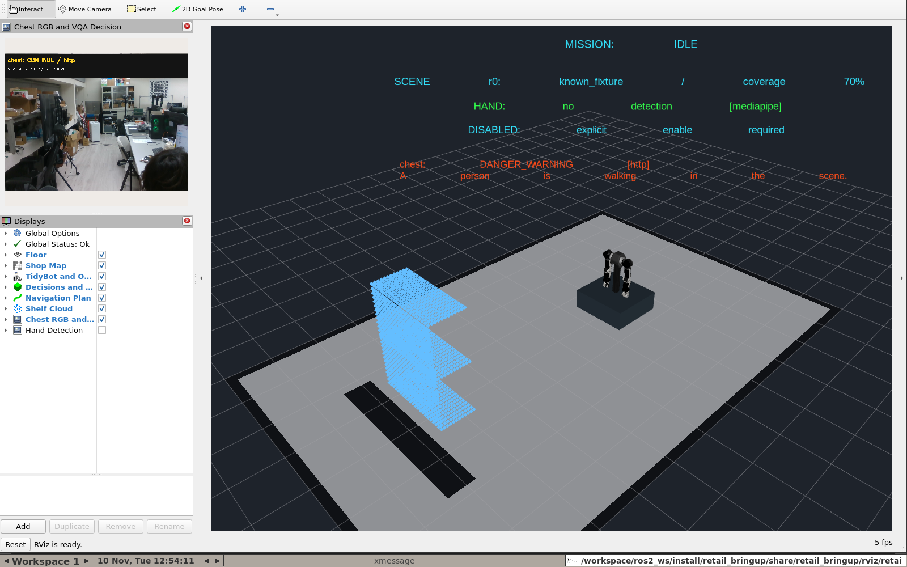

# RealSense、VQA 與 Docker 目錄整理驗收

日期：2026-11-10（Asia/Taipei）。本輪起始整合 HEAD 為 `d01fae544ae0961335484d71a8d47d9f3b5a8a54`，已有先前未提交內容；完成前唯讀查證 HEAD 已為 `02ef194c0de4a4159965ee1596fef275e9682433`（system_docker），其後仍有 README 與本輪最終證據修改。本代理未執行 commit／push。四個 external checkout 仍與 dependencies.repos 相符、工作樹乾淨；`/home/lester/VLMotion` 仍為 `889558ff0ff5f43c818ce82aa39b7b95734e7e6e`、乾淨。未改上游、模型、控制介面或防護參數。

## 已確認事實

- RealSense ROS 套件原本已安裝，本輪重新建置並核對 sim／dev 的套件。`realsense2_camera`／description 為 4.58.4，librealsense2 為 2.58.4；[完整版本](2026-11-10-realsense-versions.log)。沒有安裝到宿主機或另 clone 未鎖版本 driver。
- `make camera-list` 經 Docker daemon 成功辨識 D435，FW 5.13.0.55。代理程序看見的 `/dev`／sysfs 不等於 Docker daemon 主機的設備視圖，因此以 SDK 探測與真實影像為準。實測序號與本機配置保存在忽略的 `config/local/cameras.yaml`。
- 相機 driver 在 cameras 容器啟動，RGB8、640×480、15 FPS；depth／infra 關閉，純 RGB 研究路徑保留。[driver 實際輸出](2026-11-10-realsense-driver.log) 已將本機序號遮蔽；raw log 暫存在 `/tmp/retail-realsense-driver.raw.log`，也可重新查詢容器 logs。
- GPU worker 唯讀載入 `/home/lester/VLMotion/ros2_ws/src/lightweight_risk_vqa` 和本機 `c_policy/best`。沿用 vqa-only 的 ROBOT_QUERY、schema 驗證與 constrained decoder；不新增模型、不改權重、不使用 compact prompt 或 bbox action 覆寫。
- RGB／CameraInfo → HTTP 推論 → RiskAdvisory／annotated Image → RViz 已實際運行。觀測帶 capture stamp、來源 epoch、model／prompt hash。假機器人全程未啟用；未向實體馬達發命令。

## 映像與模型

| 項目 | 本次版本 |
|---|---|
| humble-dev | `sha256:c35b800cbd12314c899d6e555b2607967e7258ff0e2df6aa2dec44f0670f0365` |
| humble-sim（本輪重建） | `sha256:6f1cca55f1d379bf2b8b753974371262d67644d1abfb833fcfe95919a9541b21` |
| vqa-worker（重用已驗收映像） | `sha256:5dd032c358dd4dc253c98e4d5763c876f25ea17f97ce55b3fd8cd253607b3672` |
| ROS 環境 | Humble／Python 3.10／Cyclone DDS，domain 83，非 root UID/GID 1001 |
| GPU 環境 | Python 3.12.3、Torch 2.10.0+cu128、Transformers 5.15.0 |
| model.pt SHA256 | `30a2397b628c81721afde15c690122887b5a9709a9fa1bac0f7bb73f7403e619` |
| ROBOT_QUERY SHA256 | `d02131eab27f7639a650c3bcca26baae02ad80fd3d0f3558f8ed14e2ce070f21` |

sim 的 Docker build 成功建置 9 個選定 ROS 套件；本輪未重新下載／建置 GPU 相依。GPU 的 `make vqa-build` 保留可重建入口，本機實測使用上表既有 image。

## Docker 整理與設計決策

`Dockerfile` 與 Compose overlays 移入 `docker/`，根目錄只保留 include 入口 `compose.yaml`、Makefile、context 所需 `.dockerignore`。正式 Compose 的 build context 仍是專案根目錄。相機授權定義集中在 `docker/compose.realsense.yaml`，由共用設定 extends，讓每個入口都知道相機服務；camera profile 預設不啟用。序號配置 mount 留在共用配置，以確保相對路徑不被 extends 改成 docker/ 下的錯誤位置。

`make vqa` 等待模型 healthcheck，選擇外部 RGB 的 sim，再以 `--no-deps` 開啟 cameras。`make vqa-dev` 同樣配置真相機與模型，但選用可寫 overlay，先停止 cameras 再重建 sim namespace。相機啟動不會重新套用預設 sim 配置而把開發模式覆寫。`make dev-restart` 在相機運行時拒絕單獨重啟，應改用 `make vqa-dev`。

`sim`／`cameras` 共用 image、共用 network namespace、各自執行自己的程序；只有 cameras 取得 UVC／USB。GPU worker 為獨立 image，以內部 HTTP 供 ROS adapter 呼叫，不直接控制機器人。root 的 `docker compose exec sim bash` 繼續可用；overlay 鏈改用 Makefile 或顯式 `--project-directory . -f docker/compose.yaml`。

## 實際驗收與重現

| 指令／案例 | 結果 |
|---|---|
| `make camera-list` | D435 SDK 探測成功 |
| `make build` | Docker 建置成功；9 個 ROS 套件完成 |
| `make vqa` | 模型 healthy，RealSense 與 sim 啟動；[啟動輸出](2026-11-10-realsense-start.log) |
| sim 內 `python3 /workspace/scripts/check_realsense.py stream` | 收到至少 15 張真 RGB、有效內參、唯一 raw publisher、相同 optical frame、有效真模型回答與 annotated Image；[輸出](2026-11-10-realsense-stream.log) |
| `make camera-stop`，再執行 `check_realsense.py loss --timeout 15` | `DATA_LOSS`、valid=false、reason=image/result expired，假底盤保持禁動；[輸出](2026-11-10-realsense-loss.log) |
| `make vqa-dev`、`make dev-build` | 互動 shell 位於 `/workspace/ros2_ws`，模式 0、external/http、來源可寫；3 個整合套件在容器完成編譯；[編譯輸出](2026-11-10-realsense-dev-build.log) |
| 相機運行時 `make dev-restart` | 按設計拒絕，沒有重啟 sim；[輸出](2026-11-10-realsense-restart-guard.log) |
| `make vqa-video VIDEO=/data/video/0610_take3n4.mp4`，sim 內 `accept_sim.py live-vqa` | 切換影片成功；真模型 STOP 回答及 MediaPipe 有效觀測；[輸出](2026-11-10-realsense-video-mode.log) |
| `make up`，sim 內 `accept_sim.py restart` | 切回純 fixture 成功，IDLE／禁動、實測收納／靜止、沒有重播 goal；[輸出](2026-11-10-realsense-fixture-mode.log) |
| 最終 `make vqa-dev`，sim 內 stream＋restart | 真相機／VQA／overlay 同時有效，模型 DANGER_WARNING，IDLE／禁動；[最終輸出](2026-11-10-realsense-final.log) |
| launch 配置檢查 | 容器內 runpy／LaunchContext 檢查：全部停用、缺多機序號、重複序號、未知相機名稱皆拒絕；合法數字序號保持字串、RGB-only |
| 靜態檢查／顯示 | Compose config、Make dry run、shell 語法、Python AST、git diff --check 通過；X server 可連線、noVNC HTTP 200 |

Numeric serial 的 `_` 前綴處理由整合 launch 加入，依 [RealSense 官方 ROS wrapper 參數](https://github.com/realsenseai/realsense-ros#parameters) 避免 YAML 將序號解析為整數。多機序號與裝置授權仍須逐台核對。

首次開發模式檢查曾在 restart 驗收 assertion 失敗，後續截圖未執行；保留 [該次輸出](2026-11-10-realsense-dev-stream.log)。檢查發現原腳本未等待第一筆 mission state，可能造成啟動競態；已補上等待，保留原本的 IDLE／禁動／停止斷言並增加錯誤診斷，未改運動程式或延長 timeout。fixture 與最終真相機模式重新驗證通過。

實際 RViz 畫面：

## 邊界與後續

本次是功能／介面與容器驗收，不是模型正確率評估。實際輸出仍可能出現不合理文字或 schema 拒絕；沒有把 DATA_LOSS 改成安全空場，沒有為了通過測試放寬 TTL／watchdog。VLMotion 原有 YOLO-assisted、Qt UI 與舊 bbox baseline 未全部移植。

只啟用一台胸口 D435。肩部／腕部實體相機、裝配 TF 標定、三視角覆蓋、Thor、真機運動、MASt3R 尺度／腕部融合、三維動態繞行尚未驗收。sim 的裝配 TF、貨架和機器人仍屬假硬體基線。先前全任務／故障結果見 [整合驗收](2026-11-10-integration.md)，本輪未重跑全部控制故障案例。

保留既有未提交內容、權重與歷史證據；沒有清空 Docker volume、全域 prune 或修改其他專案容器。本次來源 manifest 見 [SHA256](2026-11-10-realsense-source.sha256)。
