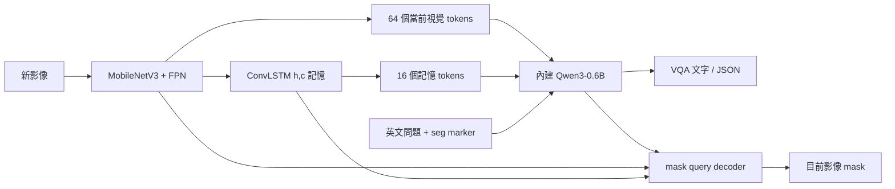
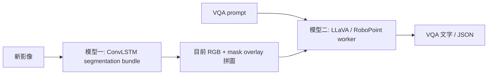

# 架構與程式閱讀

模型／資料／結果總覽先讀 [整合報告](MODEL_DATASET_REPORT.md)。維護日期：2026-10-23。兩條 VQA 共用 UI 與模型 loader，模型的分工清楚分開。

## Integrated：單一 bundle



虛線 model boundary 的概念在程式上是一個 `LightFoundationVLM`／一個完整 bundle。Qwen 的特殊 `<seg>` hidden state 與 pixel features 產生 mask；Qwen 的自回歸 generation 產生文字。VQA 直接收到 visual/memory tokens，**不把 mask 當文字模型的輸入**。Mask 與文字兩項輸出都需要相應訓練，原始 segmentation checkpoint 不會因為有 Qwen 就自動成為可靠 VQA。

`TemporalSegmenter.process()` 一次編碼一張影像，保留 ConvLSTM `(h,c)`；需要回答時復用同次 `forward()` 的 context 生成文字。影片重新循環或 query 改變會 reset state。每個相機／目標應有自己的 state，不可混用。

### 兩種無固定區域的 robot VQA 模式

`run_vqa_ui.sh vqa-only` 只載入上述一個 bundle。問題改成全畫面人物相對機器人的移動、接近意圖推測、碰撞風險與 action；mask 僅供視覺化，不取 bbox、不用停止區規則。

`run_vqa_ui.sh yolo-assisted` 載入同一 bundle，另外用 YOLOv8n 偵測逐人 bbox。`PersonMotionHints` 將因果短歷史的框高與中心變化組成文字，和原問題一起送進**同一次** Qwen generation。YOLO 是輔助模型，不是第二個 VQA 模型，也不負責輸出 action。

```text
A: NOW → MobileNet/FPN → ConvLSTM記憶 → 內建Qwen → 描述／方向／意圖推測／風險／action
B: A的相同視覺與記憶路徑 ──────────────────→ 內建Qwen → 同一組回答欄位
   NOW → 額外YOLOv8n → bbox短歷史 → 文字證據 ────↗
```

兩種模式均不畫停止區、通道或人物框；不以畫面區域強制覆蓋 action。`robot_vqa.py` 定義契約及驗證，`availability.py` 保留 DATA_LOSS 健康層。現有 state checkpoint 尚未訓練完整 robot schema／意圖與風險，需看實際 raw output，不能把換入口當成模型能力已完成。指令與訓練資料需求見 [INTERFACES](INTERFACES.md#convlstm-vqa-ui無固定區域的兩種模式)。

新模式預設使用 `robot_decoding.py` 的 token 文法：同一 Qwen 的 motion／intent／risk 選擇受到合法集合約束，action 與 risk 配對也在生成時限制；observation／explanation 保留模型英文文字。這不改模型權重、visual prefix 或 ConvLSTM，不是第二個 VQA，也沒有文字生成後的 action 改值。可選 `--robot-decoding free` 比較；兩者的字面格式與影像理解準確率應分開評估。

### 可選的同模型 motion head（2026-10-23）

新 recovery C bundle 在 ConvLSTM 的 pooled 64 維 hidden state 後增加 `Linear(64,5)`，與 Qwen 同 bundle。`predict_events()` 可跳過 language model／mask decoder；UI 的 `--fast-motion-head` 則重用同次 segmentation forward 的 event logits，Qwen 仍產生 VQA。這是同模型內的功能分工，不是外接另一個 VLM。

head 輸出只學幾何弱標籤方向；可選政策將靠近映為 warning，其餘按信心顯示 CONTINUE／OBSERVE，健康問題為 DATA_LOSS。UI 明示判斷來源，沒有固定區域或框，也沒有訓練碰撞 STOP。LoRA 的 28 層 attention adapters 在存檔時合併，部署 graph 不增加 adapter 分支。資料、真值限制與實測見 [整合報告](MODEL_DATASET_REPORT.md)。

### 分割計算可關閉

`--no-segmentation` 只用於 embedded robot 模式：跳過 mask／presence、分割專用 Qwen prepass 與 overlay，保留視覺 tokens、ConvLSTM state 與 VQA generation。模型參數仍在原 bundle 內；不需重訓。UI 隱藏 mask 欄並顯示 Seg OFF。一般開啟分割時，上圖仍適用。

## External baseline：兩個模型



模型一內仍包含供 mask query 使用的 Qwen；文字回答由**另一個**外部 worker 產生。外部 VLM 不直接取得 `(h,c)`／memory tokens，因此不能把答案宣稱為內建 Qwen 的回答。Mask 執行緒與 worker 請求分開，worker 慢時畫面仍更新；不代表每個畫面都有新 VQA。

HTTP contract 保留：controller `/list_models`、`/get_worker_address`，worker `/worker_generate_stream`；JPEG 為 base64，回覆是 null-delimited JSON stream。`task_type=risk_assessment`、`use_sam3_candidates=false`，維持既有 worker prompt 行為。

## 第三條比較工具：bbox MotionLSTM

YOLOv8n → ByteTrack → 每人 16×10 bbox features → MotionLSTM → 五類方向。這個 LSTM 重算已保留的 feature window，與像素 ConvLSTM 的 persistent hidden state 不同；它不看像素、不能回答拿商品等活動。ROS adapters 可沿用 `future_risk_vqa` 的 UI／policy；見 [BASELINES](BASELINES.md)。

## 依序閱讀程式

| 工作 | 程式入口 |
|---|---|
| 整合模型結構與訓練解凍範圍 | `light_foundation_vlm/model.py` → `memory.py` → `vision.py` |
| bundle 與前處理 | `light_foundation_vlm/checkpoint.py`、`data.py` |
| loss／optimizer／選模 | `light_foundation_vlm/train.py`、`losses.py`、`sampling.py` |
| 兩種即時 UI | `lightweight_risk_vqa/light_foundation_live_ui.py` |
| 無固定區域 VQA／YOLO 輔助與驗證 | `lightweight_risk_vqa/robot_vqa.py` → `light_foundation_live_ui.py` |
| Robot JSON／欄位組合的生成限制 | `lightweight_risk_vqa/robot_decoding.py`；不是辨識模型或新 checkpoint |
| 舊幾何規則對照（新模式不使用） | `lightweight_risk_vqa/camera_policy.py` → `config/camera_policy.json` |
| worker 協定與解析 | `lightweight_risk_vqa/worker_client.py` |
| 資料製作 | `prepare_jaad_vqa.py`、`make_temporal_vqa_dataset.py`、`prepare_mixed_vqa.py`、`prepare_grounded_vqa.py` |
| VQA／mask 評估 | `temporal_vqa_infer.py`、`evaluate_grounded_masks.py`、`vqa_metrics.py` |
| ROS 接線與設定 | `launch/` → `config/` → `launching.py` |

## 記憶、時間與限制

訓練使用 8 步、2 Hz、歷史約 3.5 秒；舊 future 任務的 label 看 NOW+1 秒，新 recovery 的方向代理只使用過去到 NOW。學生輸入只能到 NOW。`time_unit=frames` 指採樣步而不是原始影片 FPS。線上頻率應和訓練相符；UI 的生成耗時會影響實際頻率，設定 2 Hz 不保證吞吐量。

本架構是一次 query 的 binary mask，可表示多人 union，沒有自動提供 instance IDs 或跨相機 ReID。新 robot 模式固定 mask 用 `the people`、VQA 復用80-token visual/memory prefix配合指定問題；舊 model 決策模式只有 state 問題自動分開 mask query。YOLO 輔助的局部 bbox 關聯不是模型學出的 IDs，也不等於 ConvLSTM 已學會方向。訓練綠框與 raw-video UI 也有落差。這些限制與目前準確率見 [整合報告](MODEL_DATASET_REPORT.md)，不能用 state 有更新或 loss 低來證明時間理解成功。
