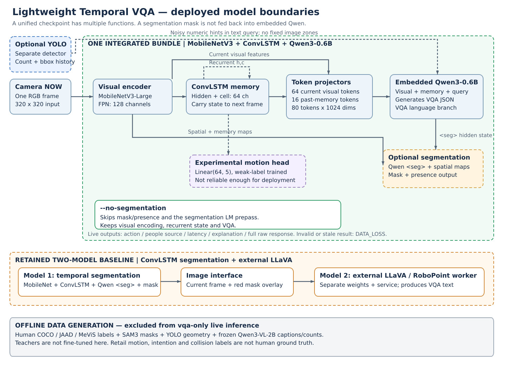
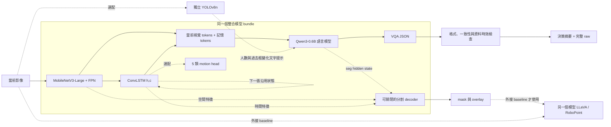

# Lightweight Temporal VQA：模型、資料集、訓練與推論整合報告

更新日期：2026-10-23。範圍：目前使用的 `c_policy/best`、本輪 A／B／C 與 balanced／last-layer 對照，以及保留的外接 LLaVA baseline。資料數量以實際 JSONL 為準，參數以 `training_args.json` 和 bundle manifest 為準。

**目前已改善基本看圖與 COCO 人物分割，但沒有證明 ConvLSTM 學到了可靠的時間語意，方向／意圖／碰撞判斷也尚不可靠。** 表格會分開標示人工真值、弱標籤符合率、格式通過率與延遲，不能互相替代。

## 閱讀目錄

1. [系統與模型架構](#1-系統與模型架構)
2. [訓練用 dataset](#2-訓練用-dataset)
3. [Finetune 範圍與訓練參數](#3-finetune-範圍與訓練參數)
4. [現有模型表現](#4-現有模型表現)
5. [實際 prompt 與訓練差異](#5-實際-prompt-與訓練差異)
6. [模型輸出與最終決策](#6-模型輸出與最終決策)
7. [使用、續訓與檔案位置](#7-使用續訓與檔案位置)
8. [限制與下一階段優先事項](#8-限制與下一階段優先事項)

## 1. 系統與模型架構

### 1.1 架構圖片：實線為主要路徑，虛線為選配或模型邊界



[可縮放 SVG 原圖](assets/model_system_overview.svg)。圖片內刻意區分「同一個 bundle 內的不同功能」、「外部 YOLO」、「外接 LLaVA」，以及只在離線標註時使用的教師。

以下 Mermaid 也保留在此 MD；即使只帶走這份文件，仍有架構定義：



### 1.2 元件與功能

| 元件 | 目前設定 | 功能與邊界 |
|---|---|---|
| 視覺 encoder | `MobileNetV3-Large`，四尺度 stride 4／8／16／32 | 自建 VLM 的視覺特徵來源；不是 Qwen3-VL 的原生 vision encoder |
| FPN | 128 channels | 合併空間尺度，供視覺 tokens、記憶與 mask 共用 |
| ConvLSTM | `SpatialLSTM`，hidden/cell 64 channels | 對每次輸入更新 h,c；320×320 輸入下，記憶位於 stride 16 的 20×20 網格 |
| 當前視覺 tokens | 8×8＝64 tokens | 由當前 FPN 特徵池化、投影至 Qwen hidden size 1024 |
| 記憶 tokens | 4×4＝16 tokens | 從 ConvLSTM hidden state 池化、投影；總視覺 prefix 為 80 tokens |
| 語言模型 | `Qwen3-0.6B`，28 層、hidden size 1024 | 讀取視覺／記憶 prefix 與問題，生成 VQA 文字；不是離線教師 Qwen3-VL-2B |
| 分割功能 | Qwen 的 `<seg>` hidden state＋空間／時間特徵 → mask／presence | 同 bundle 的另一個輸出分支；最後 mask **沒有回灌給 embedded VQA** |
| 可選快速頭 | `Linear(64,5)`，325 parameters | 讀取平均池化記憶，不需文字生成；目前效果不足，預設停用 |
| 可選 YOLO | 本機 `yolov8n.pt`，偵測解析度預設 416 | 獨立模型，提供人數、框及簡單 IoU 關聯歷史；沒有固定 ROI 或畫面區域決策 |
| 外接 baseline | 第一個分割 bundle＋另一個 LLaVA／RoboPoint worker | 原圖與 mask overlay 交給外部模型回答；兩個模型，和 embedded 路線分開 |

C 的部署 graph 約 **599.8M parameters**；訓練時另有暫時 LoRA 分支，所以 training total 約 602.1M。LoRA 會在存檔時合併，不增加部署時的 adapter 分支。

### 1.3 segmentation 開關與記憶

- 預設分割開啟；`--no-segmentation` 支援 embedded `vqa-only`／`yolo-assisted`。
- 關閉時跳過 mask／presence 解碼、分割用 Qwen prepass、遮罩 resize／疊圖與 mask bbox；保留 encoder、FPN、ConvLSTM、VQA，以及可選 YOLO。
- 權重仍在 bundle 內；這是計算路徑切換，不代表自動刪除分割參數或釋放等量顯存，也不需要重訓。
- 外接 worker baseline 仍需要 frame＋mask，不使用此開關。分割監督在訓練中仍有使用，和推論是否輸出 mask 是兩件事。
- 訓練最多 8 個過去→NOW 步驟；UI 每次送一張，沿用 h,c，換問題或影片 loop 時重置。這沒有使用未來一秒影像。
- C 使用 `time_unit=frames`、步距 dt=1；不是有公尺、秒或相機運動校準的物理軌跡模型。零售抽樣每 0.5 秒一張，但其他來源的物理間隔可能不同。

## 2. 訓練用 dataset

容器 `/workspace` 對應主機 `/home/lester/VLMotion`。主要新資料根目錄：`/workspace/datasets/robot_vqa_recovery_v1`。

### 2.1 C 模型實際資料清單

以下計數是任務列數；相同影像可同時有 count、presence、caption 等任務，**不是獨立影片數量，也不是完整公開 dataset 的規模**。

| Dataset／任務 | Train | Val | 輸入 | 監督來源 | 主要訓練能力 |
|---|---:|---:|---|---|---|
| COCO 人數 count | 1,600 | 160 | 單張全畫面 | 官方人工 person annotations，排除 crowd | `person_count`／`person_present` |
| COCO 人物存在 presence | 1,600 | 160 | 同一批 COCO 圖片 | 官方人工 annotations | yes／no |
| COCO 場景 caption | 1,600 | 160 | 同一批 COCO 圖片 | 官方人工 captions | 基本視覺語言對齊、描述 |
| COCO all-person union masks | 2,504 | 263 | 單張全畫面 | 官方人工 person masks，含空目標 | 人物分割與 presence head |
| JAAD target-person state | 1,270 | 243 | 8 步，目標人物有綠框提示 | 人工 walking／standing 狀態，轉換由標籤生成 | NOW 活動、STARTED／STOPPED／STEADY |
| MeViS 人物相關表達式＋mask | 211 | 45 | 8 步＋自然語言指稱 | 人工 expression／mask；選取人物相關子集 | 動作／時間關係的指稱分割 |
| 便利商店教師 caption | 20 | 3 | 8 步全畫面 | Qwen3-VL-2B 只看 NOW 產生候選，未人工複核 | 場域描述 |
| 便利商店教師 count | 20 | 3 | 同一批 8 步 | Qwen3-VL-2B NOW 人數，附 YOLO 候選對照，未複核 | 場域人數 |
| 便利商店教師 mask | 20 | 3 | 同一批 8 步 | SAM3 NOW all-person union mask，未複核 | 場域人物分割 |
| JAAD 因果方向／policy | 161 | 48 | 原影片重解碼，8 步、無綠框 | 人工框轉換成過去幾何代理；方向／風險／意圖皆弱標籤 | 全場景方向問答、政策與 event head |
| 便利商店因果方向／policy | 20 | 3 | 同一批 8 步、無提示框 | YOLO 框歷史→幾何代理；未人工複核 | 場域方向／policy 與 event head |
| **合計** | **9,026** | **1,091** | — | 人工與弱監督混合 | — |

COCO masks 的 train 正例／空目標是 **1,960／544**，val 為 **204／59**。零售 20／3 段各產生 caption、count、mask 三列，所以 `weak_retail` 共 60／9 列；`weak_robot` 共 181／51 列。

### 2.2 資料位置與拆分

| 內容 | 路徑（相對主要新資料根目錄） |
|---|---|
| COCO grounding 三任務 | `grounding/{train,val}.jsonl` |
| 零售原始片段、每步 YOLO 框 | `retail/clips.jsonl` |
| Qwen3-VL 教師結果 | `retail/teacher.jsonl` |
| SAM3 遮罩與候選 | `retail/sam3/` |
| 零售三任務 | `retail/{train,val}.jsonl` |
| 幾何方向／policy 任務 | `causal_motion/{train,val}.jsonl` |
| 真正交給 trainer 的清單 | `stages/{a,b,b_balanced,c}_{train,val}.jsonl` |
| 人工複核入口 | `retail/review.html`、`retail/review_template_v2.csv` |
| 拆分、資產與契約檢查 | `dataset_audit.json` |

圖片／mask 大多由 JSONL 引用既有資產，沒有全部複製進這個目錄；單獨搬移 JSONL 不足以訓練。既有 COCO／JAAD／MeViS 來源分別位於 `datasets/grounded_vlm_v2/`、`datasets/light_foundation_vqa/`／`datasets/external/JAAD/`、`datasets/mevis_person_v2/`。

零售 train：`0610_take1n2`、`0610_take3n4`、`0616x9`；development val：`0617x9`。同一錄影日歸同一 group。常用 demo `0610_take3n4.mp4` 已在訓練中，不能當成泛化測試；`0626x9` 本輪未訓練，但歷史上看過，也不是新盲測。

### 2.3 各訓練階段資料量

| 階段 | Train 列數 | Val 列數 | 差異 |
|---|---:|---:|---|
| A／A control | 5,024 | 552 | COCO grounding＋64／32 state＋160／40 masks |
| B | 8,785 | 1,031 | 完整 human state／COCO masks／MeViS，加 grounding |
| B balanced | 8,785 | 1,031 | 和 B 同資料，只平衡 state 的四種活動／轉換抽樣 |
| C | 9,026 | 1,091 | B＋60／9 零售任務＋181／51 因果方向任務 |

原 with_mevis baseline 是繼承的舊 checkpoint，不是從零初始化。其直接上一輪 joint dataset 為 **4,039 train／551 val**：COCO masks 2,504／263、JAAD state 1,270／243、MeViS 211／45、舊 SAM3 候選 54／0；直接初始化自 `person_state_teacher_v1/train_memory/best`。本輪 A／B 清單沒有再納入那 54 筆舊候選，但會繼承舊權重已學到的內容。這份報告沒有將所有更早的預訓練資料誤算成本輪新增資料。

### 2.4 弱標籤如何形成

| 過去到 NOW 的幾何 | 方向候選 |
|---|---|
| 人框高度增加 >12% | TOWARD_CAMERA |
| 人框高度減少 >12% | AWAY_FROM_CAMERA |
| 水平中心移動 >畫寬 8% | LATERAL_ACROSS_VIEW |
| 框高變化 <6%、水平位移 <3.5% | STATIONARY |
| 其餘或無法合併 | UNCERTAIN |

全畫面有任一 TOWARD 候選時取 TOWARD；沒有靠近但多人方向無法合併時取 UNCERTAIN。這是教師幾何代理，不是經過相機自運動補償的真值。

| C 的方向類別 | Train | Val |
|---|---:|---:|
| TOWARD_CAMERA | 106 | 31 |
| AWAY_FROM_CAMERA | 10 | 0 |
| LATERAL_ACROSS_VIEW | 8 | 5 |
| STATIONARY | 12 | 3 |
| UNCERTAIN | 45 | 12 |
| 合計 | 181 | 51 |

方向代理再映射：TOWARD→LIKELY／ELEVATED／DANGER_WARNING；已知非靠近→UNLIKELY／LOW／CONTINUE；不明→UNCERTAIN／OBSERVE。**沒有可靠碰撞標註，所以訓練 target 沒有 IMMINENT／STOP；`approach_intent` 也是政策代理，不是人的心理意圖。**

Qwen／YOLO 的 NOW 人數在 23 段中有 17 段一致、6 段不同；一致也不代表正確。零售本輪沒有人工通過的標註。SAM3／YOLO／Qwen3-VL 都只離線生成候選，這輪沒有 finetune 這些教師。

## 3. Finetune 範圍與訓練參數

### 3.1 初始化與模型版本

| 版本 | 初始化 | 最佳 epoch | 可訓練參數 | bundle（相對 `/workspace/checkpoints`） |
|---|---|---:|---:|---|
| 原 baseline | 更早的 train_memory | — | 舊輪：完整最後一層等模組 | `person_state_mevis_ablation_v1/with_mevis/best` |
| A LoRA | 原 baseline | 1 | 2,880,770 | `robot_vqa_recovery_v1/a_lora/best` |
| A last-layer control | 同一原 baseline | 1 | 16,317,954 | `robot_vqa_recovery_v1/a_last_layer/best` |
| B temporal | A LoRA best | 2 | 3,325,698 | `robot_vqa_recovery_v1/b_temporal/best` |
| B balanced | A LoRA best | 1 | 3,325,698 | `robot_vqa_recovery_v1/b_balanced/best` |
| C policy，目前 UI 範例使用 | B temporal best | 1 | 3,326,023 | `robot_vqa_recovery_v1/c_policy/best` |

B balanced 不是 C 的初始化。A／control／balanced／C 選 epoch 1、B 選 epoch 2。C epoch 2 的 head 曾達 41.2% 符合率，但整體選模 loss 較差，不能拿該數字當成已選 C checkpoint 的表現。

### 3.2 哪些模組有改動

| 模組 | A LoRA | A control | B／balanced | C |
|---|---|---|---|---|
| MobileNet encoder／BatchNorm | 凍結 | 凍結 | 凍結 | 凍結 |
| FPN | 訓練 | 訓練 | 訓練 | 訓練 |
| ConvLSTM | 凍結 | 凍結 | 訓練 | 訓練 |
| Visual／memory projectors、位置、seg embedding | 訓練 | 訓練 | 訓練 | 訓練 |
| Temporal-to-pixel／pixel decoder／mask query／bias／presence head | 依分割監督訓練 | 同左 | 同左 | 同左 |
| Qwen 28 層 attention 的 q/k/v/o | LoRA | 僅第 28 層完整解凍 | LoRA | LoRA |
| Qwen embedding／其餘 MLP／norm | 凍結 | 最後一層內 MLP／norm 也解凍，其餘凍結 | 凍結 | 凍結 |
| 5 類 event head | 無 | 無 | 無 | 新增並訓練，325 parameters |

LoRA rank=8、alpha=16，作用於 28 層 `q_proj,k_proj,v_proj,o_proj`，是本專案 native 實作，沒有依賴 PEFT。每階段從上一個已合併 bundle 繼續，再掛新的 LoRA；存檔再合併。tensor audit 沒發現宣告外的凍結模組變動；A 的 ConvLSTM 未變，B／balanced／C 的確有變。

### 3.3 本輪五組共同參數

| 參數 | 實際設定 |
|---|---|
| GPU／環境 | RTX 5070 12GB；Python 3.10.12、Torch 2.11.0+cu128、Transformers 5.13.1 |
| Stage | joint、多任務；encoder 凍結 |
| 尺寸／序列 | 320×320、最多 8 步、frame-step 時間單位 |
| Batch／epoch／抽樣 | batch 1；2 epochs × 每輪 1,600 replacement draws＝每組 3,200 updates |
| Optimizer | AdamW、weight decay 0.01、gradient clipping 1.0 |
| Learning rate | 主要可訓練模組 1e-4；語言 5e-5；vision_lr 設 1e-5，但 encoder 凍結，實際不更新 |
| Precision | Qwen bf16；視覺／記憶 fp32 |
| Seed／augmentation | seed 42；本輪 augment=false |
| Loss | 有監督的任務才計：2×mask BCE＋2×mask Dice＋presence＋language CE＋event CE；各非 mask 權重 1 |
| 選模 | 各 `mix_group` validation loss 等權平均，取最低；C 包含弱標籤 loss |
| 儲存 | 只保存 best；每組有 training_args、trainable_parameters、metrics、progress 與 TRAINING_COMPLETE |

列數超過每輪抽樣數，3,200 updates 不代表遍歷整份清單；這是單 seed pilot，不是大規模收斂證據。A LoRA 和 A control 是相同更新預算，不是相同參數量或 FLOPs。

| 訓練組 | 任務抽樣權重 |
|---|---|
| A／control | count 30%、presence 15%、caption 30%、state 5%、human mask 20% |
| B | count 15%、presence 10%、caption 15%、state 30%、human mask 25%、MeViS 5% |
| B balanced | 和 B 相同；state 內 WALKING/STEADY、WALKING/STARTED、STANDING/STEADY、STANDING/STOPPED 各 7.5% |
| C | count 10%、presence 5%、caption 10%、state 10%、human mask 20%、MeViS 5%、零售三任務 15%、weak motion 五類各 5% |

## 4. 現有模型表現

**口徑：以下模型比較使用當時固定的評估程式與 prompt，重新載入選定 bundle。最後的 runtime prompt／一致性修正沒有重跑全部 benchmark；不能把歷史 schema 100% 當成目前 UI 必然 100% 有效。** 全部是 development validation，不是新的盲測。

### 4.1 基本人數與是否有人：人工 COCO 真值

| 模型 | Count exact accuracy，160 張 | Presence accuracy，160 張 |
|---|---:|---:|
| 原 baseline | 0.0% | 0.0% |
| A LoRA | 51.9% | 86.9% |
| A last-layer control | 55.0% | 82.5% |
| B | 51.9% | 89.4% |
| B balanced | 47.5% | 85.6% |
| C | 55.0% | 89.4% |
| 多數類基準 | 29.4% | 70.6% |

上表是自由生成；原 baseline 在新任務的格式失敗計錯，**0% 不是說它所有能力皆為零**。限制為有限答案後，baseline count=15.0%、presence=41.9%，C count=55.0%。原生凍結 `Qwen3-VL-2B-Instruct` 的同一 count 測試是 **78.1%**，但它是較大的原生 VLM、沒有 ConvLSTM，也不是本輪 finetune 的模型。公開 COCO 可能已在它的預訓練中。

開放式 caption 仍有明顯幻覺，例如花瓶／籃子圖片被描述成人或食物；目前沒有可報告的完整人工 caption accuracy。

### 4.2 人物／指稱分割

固定 320×320、threshold 0.5；mIoU 越高越好，空目標 any-pixel FP 越低越好。

| 模型 | COCO positive mIoU（204） | COCO negative FP（59） | MeViS positive mIoU（36） | MeViS negative FP（9） |
|---|---:|---:|---:|---:|
| 原 baseline | 48.0% | 81.4% | 12.2% | 88.9% |
| B | 63.5% | 18.6% | 7.5% | 0.0% |
| B balanced | 58.7% | 28.8% | 13.1% | 11.1% |
| C | 63.5% | 25.4% | 5.3% | 0.0% |

A／control 沒有本輪對應的分割評估，不填成零。C 改善 COCO 人物分割，MeViS 卻退步；沒有單一全面最優版本。便利商店 mask 沒有人工真值，因此不能報它的真實 mIoU。

### 4.3 時間理解：64 筆人工 JAAD 分層子集

表內為「活動 macro-F1／轉換 macro-F1」，單位 %；所有條件的 NOW 相同，無效 schema 計錯。

| 模型 | 完整 8 步 | 打亂過去 7 步 | NOW 重複 8 次 | 只看 NOW |
|---|---:|---:|---:|---:|
| 原 baseline | 55.5／25.9 | 56.7／22.5 | 57.5／25.8 | 0.0／0.0 |
| B | 42.9／22.7 | 42.9／22.7 | 42.9／22.7 | 11.1／8.9 |
| B balanced | 56.6／20.5 | 57.7／21.7 | 60.1／17.1 | 0.0／0.0 |
| C | 42.9／22.7 | 42.9／22.7 | 42.9／22.7 | 42.3／22.9 |

固定 WALKING 的活動 macro-F1=42.9%，固定 STEADY 的轉換 macro-F1=22.7%。B／C 的 31 個非 STEADY 事件皆未判對，balanced 只判對 1 個。目前沒有穩定證據顯示正確歷史優於重複 NOW。

baseline last-only 只有 1/64 schema 合格，balanced 0/64；full／last 差距不能當作記憶成功。repeat 後仍拿原 target 比較，只是診斷，不是為反事實影片重新建立真值。這份人工狀態資料只支持 WALKING／STANDING，不是驗證所有活動 enum。

### 4.4 方向與決策：51 筆弱幾何標籤的符合率

| 模型／解碼 | Motion agreement | Motion macro-F1 | Robot schema 通過率 |
|---|---:|---:|---:|
| 原 baseline，free | 2.0% | 1.5% | 3.9% |
| 原 baseline，constrained | 51.0% | 17.6% | 100% |
| C，free | 45.1% | 20.9% | 94.1% |
| C，constrained | 45.1% | 20.0% | 100% |
| C fast motion head | 23.5% | 14.8% | 不生成文字 |
| 固定選 TOWARD 的基準 | 60.8% | 18.9% | — |

C action agreement=47.1%。**這不是人類確認的碰撞／意圖準確率。** Val 沒有 AWAY 樣本，macro-F1 只平均有真值的類別；不能宣稱已驗證遠離能力。0.7 head 門檻的有效覆蓋率為 0%，fast 模式會大量 OBSERVE，暫不推薦用它取代 Qwen。

### 4.5 延遲：分開看測量範圍

| 測試 | p50 | 範圍與限制 |
|---|---:|---|
| C 六欄 robot VQA，free | 約 539ms | 純文字 generation，不含讀圖與 vision／mask prepass |
| C 六欄 robot VQA，constrained | 約 802ms | 同上；文法不保證更快 |
| C 人數回答 | 約 129ms | 前 24 張，vision＋prefill＋generation；中位輸出 12 tokens |
| 原生 Qwen3-VL-2B 人數回答 | 約 263ms | 同批圖、同類任務，中位輸出 22 tokens；非單因子架構對照 |
| C incremental vision＋memory＋head | 2.42ms，p95 2.77ms | 50 次 warm、已有 h,c；不含 CPU 輸入、mask、Qwen 或 UI |
| VQA-only 影片 UI（分割開啟） | 約 960ms | 輸入影格→文字發佈，6 筆取 warm median |
| YOLO-assisted 影片 UI（分割開啟） | 約 1,283ms | 同上，非嚴格同相位／同輸出長度對照 |
| Fast head＋Qwen UI（分割開啟） | 視覺 85ms／文字 889ms | 本張先發視覺，但下一張仍會被同執行緒的 generation 延後 |

環境 RTX 5070 12GB。不同任務、token 數和測量邊界不可直接相除宣稱全面加速。關閉分割已跑過實際 UI，但本輪沒有控制同一輸入／同一答案長度量出「開關分割的公平加速比」。UI `segmentation_ms` 包含 vision／memory 與分割 prepass，不是只有 mask decoder 的時間；關閉後改顯示 `visual_memory_ms`。

### 4.6 最近 prompt 實驗與 UI

同一批 12 段、同一歷史與 NOW、同一更新後 decoder，交替順序比較：

| 指標 | 原 prompt＋原 YOLO hints | compact＋精簡 hints |
|---|---:|---:|
| 輸入 tokens 中位數 | 463.5 | 400.5（少 13.6%） |
| 輸出 tokens 中位數 | 69 | 72 |
| vision＋prefill＋generation warm p50 | 680ms | 710ms |
| 最後一致性檢查通過 | 11/12 | 7/12 |

這次沒有真值，通過率不是準確率，也沒有獨立隔離 decoder 的影響。compact 沒有更快、仍會抄寫欄位／泛化描述，所以不設為預設。實際 8 秒 UI smoke：compatible 4 次回答有 3 次有效；compact 3 次全被攔下，smoke 因沒有有效回答而失敗。不是把失敗案例移除後只報成功。

## 5. 實際 prompt 與訓練差異

### 5.1 這裡有沒有真正的 system role？

**整合模型沒有另建 chat messages 的 system role。** 程式使用「視覺／記憶 prefix＋一般文字 query＋`\n<seg>\n`」；使用者所說 system prompt，在此對應 `ROBOT_QUERY`／`COMPACT_ROBOT_QUERY`。沒有套 Qwen chat template 或額外的 thinking 對話。生成設定為 greedy `do_sample=False`。

目前預設 `--robot-prompt compatible`，`--robot-prompt compact` 是實驗選項。手動 `--query` 優先，會改變問題契約。default max_new_tokens=192；constrained 文法最多保留 observation 24 tokens、explanation 32 tokens，其他為固定 JSON／有限 enum。到完整句末會結束該文字欄位，上限仍可能截斷不良生成，不能保證流暢。

### 5.2 預設 compatible prompt：程式原文

```text
This is a robot forward camera. Use the current image and visual memory to assess people moving
relative to the robot. Describe visible movement briefly; omit gender and clothing unless clearly
supported by the original image. Mask colors are annotations. Return one JSON object in this order:
observation, motion, approach_intent, collision_risk, action, explanation. Use short observation and
explanation phrases consistent with the choices. motion: TOWARD_CAMERA, AWAY_FROM_CAMERA,
LATERAL_ACROSS_VIEW, STATIONARY, or UNCERTAIN. approach_intent: LIKELY, UNLIKELY, or UNCERTAIN.
collision_risk: IMMINENT, ELEVATED, LOW, or UNCERTAIN. Decision policy: if motion is TOWARD_CAMERA
OR approach_intent is LIKELY, set collision_risk to ELEVATED and action to DANGER_WARNING. Use
IMMINENT and STOP instead only when visible evidence supports an imminent collision. LOW and
CONTINUE are allowed only for AWAY_FROM_CAMERA, LATERAL_ACROSS_VIEW, or STATIONARY with UNLIKELY
approach intent and no visible hazard. Otherwise use UNCERTAIN and OBSERVE. Explain the same motion
and decision you selected. Infer intent cautiously; size alone does not prove intent. Consider
camera motion and occlusion. YOLO measurements, if present, are noisy supporting evidence. Use no
fixed zones. Invent no distances or future observations.
```

### 5.3 可選 compact prompt：程式原文

```text
This is a robot forward camera. Use the current image and visual memory to assess people moving
relative to the robot. Return one JSON object in this order: observation, motion, approach_intent,
collision_risk, action, explanation. Use one short sentence each for observation and explanation;
describe evidence, not instructions. Assess the highest-risk visible person; identify
left/center/right when possible. Do not combine different people into one motion. motion:
TOWARD_CAMERA, AWAY_FROM_CAMERA, LATERAL_ACROSS_VIEW, STATIONARY, or UNCERTAIN. approach_intent:
LIKELY, UNLIKELY, or UNCERTAIN. collision_risk: IMMINENT, ELEVATED, LOW, or UNCERTAIN. Observed
approach requires ELEVATED and DANGER_WARNING; clear imminent collision requires IMMINENT and STOP.
LOW and CONTINUE require confirmed non-approach and no visible hazard. If direction evidence is
insufficient, use UNCERTAIN for motion, approach_intent and collision_risk, and OBSERVE for action;
never call missing evidence LOW. Use past-to-now changes. YOLO with fewer than two samples cannot
establish direction. Account for camera motion and occlusion. Do not guess intention, distance,
clothing or future facts.
```

### 5.4 訓練與使用是否相同？

| 比較項目 | 訓練 | 現在推論 | 是否一致／影響 |
|---|---|---|---|
| Robot 主問題文字 | weak_robot train 181／val 51 筆皆使用 compatible | 預設 compatible | **逐字相同**；已對實際 JSONL 檢查，不只語意相似 |
| Compact 問題 | 尚未用於本輪權重訓練 | 可用 CLI 選擇 | 不同；已測出指令遵循不穩定，未重新 finetune |
| YOLO 歷史文字 | weak_robot 的 query 沒有 appended hints；框用來做離線 labels | yolo-assisted 會 append 數值歷史 | 有分布差異；不能因提供數值就假定 Qwen 已懂它 |
| 對象與多人彙整 | 幾何有任一 toward 就取 toward；state 是有綠框的指定人物 | 全場景問答；compact 要求最高風險可見人物 | 不完全一致，是混淆人物的可能來源 |
| 視覺時序 | 最多 8 步；多數都是 8 步，dt 為 frame steps | 一次一張，h,c 可累積超過 8 步 | 串流狀態已驗證可正確傳遞，但長歷史語意泛化未驗證 |
| 單張 count／presence／caption | COCO 單張不同問題；零售同類問題 | robot UI 預設不問人數 | 有數人訓練，不代表 robot JSON 會輸出人數 |
| 目標 state prompt | 綠框指定人物、current_activity／observed_transition；明令 motion=UNCERTAIN、action=OBSERVE | robot prompt 要方向、意圖、風險與 action | 任務與 target 契約不同；不能把 state 任務 OBSERVE 誤當決策能力 |
| STOP／IMMINENT | prompt enum 中有；weak policy target 沒有正例 | 文法允許模型選出 | 有能力缺口；enum 可輸出不代表已學會判斷 |
| 把缺證據當 LOW 的檢查 | 訓練沒有這輪新增的文字檢查 loss | runtime 會拒絕明示矛盾 | 是推論驗證，不是重訓，也不是語意保證 |

目前 YOLO appended text 格式如下，完整原始 metadata 保留在 UI 技術報告，傳給 Qwen 時只保留必要數值：

```text
YOLO past->NOW (normalized xyxy):
{"people_detected":1,"people_omitted":0,"people":[{"id":1,"bbox":[0.2,0.1,0.4,0.7],"samples":4,"history_s":1.5,"center_delta_xy":[0.01,0.02],"height_change_fraction":0.15}]}
```

上例只示範一人的提示結構，不是某次真實推論。`bbox` 是 normalized xyxy；短暫 ID 由 IoU 關聯，不是可靠重識別或跨相機追蹤。YOLO hints 是輸入證據，沒有直接覆寫 action。

### 5.5 訓練資料中其他問題／回答

| 任務 | 實際 query／形式 | 訓練 target |
|---|---|---|
| Count | `How many people are visible in this image? Return only JSON with person_count as an integer and person_present as true or false.` | `{"person_count":2,"person_present":true}` |
| Presence | `Are any people visible in this image? Answer only yes or no.` | `yes`／`no` |
| Caption | `Describe the visible scene in one short sentence.` | 人工 caption 或待複核教師描述 |
| COCO／零售 person mask | `the people` | Binary union mask、presence supervision；不是一般文字回答 |
| MeViS | 原始人物相關自然語言 expression，例如 `People fighting each other` | 對應的最後一步 mask；不是碰撞政策標籤 |
| JAAD state | 下方完整 STATE_QUERY | current_activity、observed_transition、UNCERTAIN motion、OBSERVE、explanation |
| Weak robot policy | compatible prompt | 六欄 policy JSON＋五類 event target |

```text
The target person is outlined in green in chronological frames ending at NOW. Describe the observed
activity at NOW and its transition across the sampled history. Return exactly one JSON object with
keys current_activity, observed_transition, motion, action, explanation. current_activity: WALKING,
STANDING, SITTING, BENDING, REACHING, PICKING_ITEM, PLACING_ITEM, OTHER, UNCERTAIN.
observed_transition: STEADY, STARTED_WALKING, STOPPED_WALKING, UNCERTAIN. Set motion to UNCERTAIN
and action to OBSERVE: this task does not assess future motion or robot safety.
```

外接 LLaVA baseline 則使用另一份 user prompt，經 Vicuna 樣式 `###USER:`／`###ASSISTANT:` 包裝，輸入是 frame＋mask 雙面板；不是上述 integrated query：

```text
<image>
The left panel is the current camera frame. The right panel is the same frame with the
Light Foundation temporal segmentation mask shown in red. Assess only visible evidence.
Return exactly one JSON object with these keys:
{"current_observation":"brief description", "future_prediction":"brief next likely motion",
 "motion":"TOWARD_CAMERA|AWAY_FROM_CAMERA|LATERAL_ACROSS_VIEW|STATIONARY|UNCERTAIN",
 "action":"STOP|DANGER_WARNING|CONTINUE|NO_RESPONSE|OBSERVE", "confidence":0.0,
 "explanation":"brief reason"}
Use UNCERTAIN and OBSERVE when visible evidence is insufficient. Camera geometry
computes the final robot decision separately. No markdown or extra text.
```

## 6. 模型輸出與最終決策

### 6.1 目前 robot VQA 的六個必要欄位

| 欄位 | 型別／值 | 意義與檢查 |
|---|---|---|
| observation | 非空文字 | 可見活動的描述；不能只是 enum 或抄寫 schema placeholder |
| motion | TOWARD_CAMERA／AWAY_FROM_CAMERA／LATERAL_ACROSS_VIEW／STATIONARY／UNCERTAIN | 選定評估對象的相對方向；不是公尺速度 |
| approach_intent | LIKELY／UNLIKELY／UNCERTAIN | 原契約的接近假設；目前沒有心理意圖真值 |
| collision_risk | IMMINENT／ELEVATED／LOW／UNCERTAIN | 模型風險輸出；只有政策代理監督，沒有實際碰撞驗證 |
| action | STOP／DANGER_WARNING／CONTINUE／OBSERVE | 和 risk 一對一配對；受限文法會強制一致 |
| explanation | 非空文字 | 與觀察、方向與風險一致的簡短理由；原樣保留供查錯 |

格式示例（不是已驗證的視覺結果）：

```json
{
  "observation": "The person on the left is walking.",
  "motion": "UNCERTAIN",
  "approach_intent": "UNCERTAIN",
  "collision_risk": "UNCERTAIN",
  "action": "OBSERVE",
  "explanation": "Camera motion obscures the relative movement."
}
```

| 證據／輸出契約 | 風險 | 指令 |
|---|---|---|
| 模型選 imminent collision | IMMINENT | STOP |
| 模型判 toward 或 likely approach | ELEVATED，或有迫近證據時 IMMINENT | DANGER_WARNING，或 STOP |
| 已知非靠近、UNLIKELY intent、沒有可見危險 | LOW | CONTINUE |
| 場景有效但方向／風險不足以判斷 | UNCERTAIN | OBSERVE |
| 影像／推論缺失、過期、context 不符、schema 或已知文字矛盾 | 不信任該回答 | runtime **DATA_LOSS** |

`DATA_LOSS` 是資料健康／回答有效性狀態，不是模型生成的六欄 action，也不是人物危險。若文字明說方向不足卻給 LOW，或敘述混入 JSON 欄位／重複標點，runtime 拒絕回答；不靠關鍵字偷偷改寫成 WARNING／STOP。這是有限啟發式驗證，不能判定影像中的真實動作，仍可能漏判／誤判。

受限解碼強制 JSON、合法 enum、risk/action 配對及 approaching 至少 elevated。**模型仍選方向／intent／risk，但 action 的自由度已被文法限制**；不能說六個欄位都是完全不受約束的語言推理。`--robot-decoding free` 可重現自由生成，仍須通過事後檢查。

### 6.2 人數、分割與快速頭是另外的輸出

| 輸出／來源 | 目前如何顯示 |
|---|---|
| 人數 | yolo-assisted 顯示 YOLO detections；目前 robot JSON 沒有 `person_count`，vqa-only 不從敘述猜數字 |
| 分割 | binary mask／presence，供疊圖；不是 instance ID，也不能把 mask 連通區數直接當準確人數 |
| Head | 五類 softmax；未校準 probability，暖機 8 步、低於 0.7 或不確定則 OBSERVE |
| Head 決策來源 | 明示 `temporal_motion_head_weak_proxy`，預設關閉；沒有 collision class，因此不自行輸出 STOP |
| UI raw | 底部保留完整最近模型原文，包括被拒絕的回答；上方不把過期 raw 當成目前有效理由 |
| UI 延遲／新鮮度 | VQA、vision／seg、YOLO 分列；evidence age 另列，不把模型耗時當成影格新鮮度 |

## 7. 使用、續訓與檔案位置

### 7.1 常用 UI 指令

在既有容器執行：

```bash
cd /workspace/ros2_ws/src/lightweight_risk_vqa

# 目前建議的實驗路徑：YOLO 人數／框輔助，分割關閉，訓練相容 prompt
bash scripts/run_vqa_ui.sh yolo-assisted \
  --checkpoint /workspace/checkpoints/robot_vqa_recovery_v1/c_policy/best \
  --video /workspace/example/video/0610_take3n4.mp4 \
  --no-segmentation --robot-prompt compatible

# 只跑單一整合 bundle，不載 YOLO；目前不會有獨立人數輸出
bash scripts/run_vqa_ui.sh vqa-only \
  --checkpoint /workspace/checkpoints/robot_vqa_recovery_v1/c_policy/best \
  --video /workspace/example/video/0610_take3n4.mp4 --no-segmentation
```

移除 `--no-segmentation` 恢復分割；改 `--robot-prompt compact` 測試縮短候選。需可用桌面 DISPLAY；既有測試中的 offscreen 截圖不代表已驗證真實相機或 Isaac 接口。常用 demo 含訓練片段，這些指令是展示／查錯用途。

### 7.2 訓練與續訓入口

本輪已完成五組、每組 3,200 updates；以下是重跑入口，不應覆蓋既有目錄：

```bash
# all 會跑 A、control、B、C；balanced 另外執行
bash scripts/train_recovery.sh all
bash scripts/train_recovery.sh balanced
```

若要新實驗，設定 `RECOVERY_MODEL_ROOT`／`RECOVERY_RESULT_ROOT` 指向新目錄；新資料也用 `RECOVERY_DATA_ROOT` 另存。人工複核工具是 `python3 -m lightweight_risk_vqa.apply_recovery_review`，需先填寫並複核 CSV，不能把未複核資料宣稱人工真值。

較大預算續訓入口已準備但沒有執行：

```bash
# DATA_ROOT 應是新複核版本，NEW_OUTPUT 應為不存在的新目錄
bash scripts/continue_recovery.sh DATA_ROOT INIT_BUNDLE NEW_OUTPUT 6 12000
```

這個腳本從 bundle 權重續訓、重新建立 AdamW，不恢復舊 optimizer 狀態；主／語言 LR=2e-5／1e-5、patience=2。對相同弱標籤增加重複次數不能保證改善。資料準備／逐步命令另見 [RECOVERY](RECOVERY.md)；本文件是現況整合，不宣稱已完成新的短格式重訓。

### 7.3 要看哪個檔案

| 要確認的內容 | 檔案／目錄 |
|---|---|
| 模型計算圖 | `light_foundation_vlm/model.py`、`vision.py`、`memory.py`、`config.py` |
| Native LoRA 與存檔合併 | `light_foundation_vlm/lora.py`、`checkpoint.py` |
| 訓練與抽樣 | `light_foundation_vlm/train.py`、`scripts/train_recovery.sh` |
| 實際 C 設定 | `/workspace/checkpoints/robot_vqa_recovery_v1/c_policy/training_args.json`，注意在 `best` 的上一層 |
| Bundle 權重／架構 | `c_policy/best/model.pt`、`manifest.json`、`language_config/config.json`、`tokenizer/` |
| 微調參數與變動稽核 | 各 run 的 `trainable_parameters.json`、results 下 `*_audit.json` |
| 原始訓練紀錄 | 各 run 的 `metrics.jsonl`、`progress.jsonl`、`TRAINING_COMPLETE` |
| 主問題／提示／驗證 | `lightweight_risk_vqa/robot_vqa.py` |
| 受限解碼 | `lightweight_risk_vqa/robot_decoding.py` |
| UI／分割開關／串流 | `lightweight_risk_vqa/light_foundation_live_ui.py` |
| 歷史 benchmark | `/workspace/results/robot_vqa_recovery_v1/evaluation/summary.json` 與 `index.html` |
| Prompt 配對原文與最後驗證 | `/workspace/results/robot_vqa_prompt_v2/paired_final.json`、`validation_final.json` |
| 本輪 prompt 詳細說明 | [PROMPT](PROMPT.md) |

大型 datasets／weights／影像結果不需放進 Git；本 MD、架構圖片、原始碼與小型設定可跟專案版本控制。不要把只上傳 JSONL 誤當成已提供完整資料資產。

## 8. 限制與下一階段優先事項

| 已有證據 | 仍未達成 | 下一步需要的監督／測試 |
|---|---|---|
| COCO count／presence 和分割改善 | 開放描述仍幻覺 | 真實全場景短 VQA、人物／場景 grounding，保留原生 VLM 對照 |
| h,c 在 8／16／32 步串流與同批計算一致 | 沒證明時間記憶有語意收益 | 相同 NOW 不同歷史配對、更多起步／停止事件、repeat／shuffle 消融 |
| 已有 JAAD／YOLO 過去幾何代理 | 無人工接近意圖／碰撞真值 | 新錄影日、相機自運動／遮擋標記、人工確認方向；STOP 的明確真值 |
| compact 可少 13.6% 輸入 tokens | 回答沒更短也沒更準 | 一致短格式再訓練，而非持續堆 prompt 規則 |
| 分割可關閉、head 計算快 | 文字 generation 仍主要延遲、head 不可靠 | 在同輸入／同答案長度測分割開關，再評估小型時序頭與 VQA 分工 |

不能用 schema 通過率、token accuracy、低 train loss 或會變化的 hidden state，代替「看懂人物移動與能做可靠決策」的證據。
